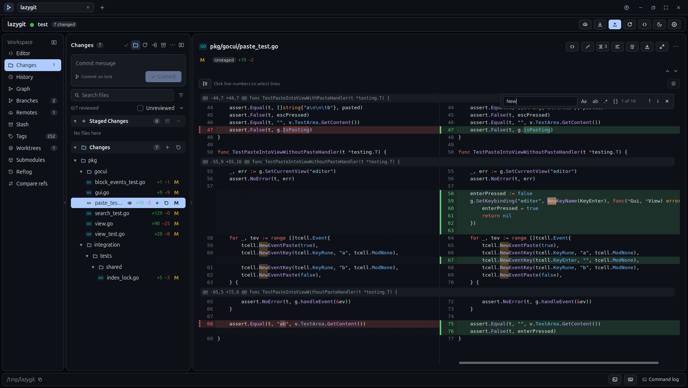
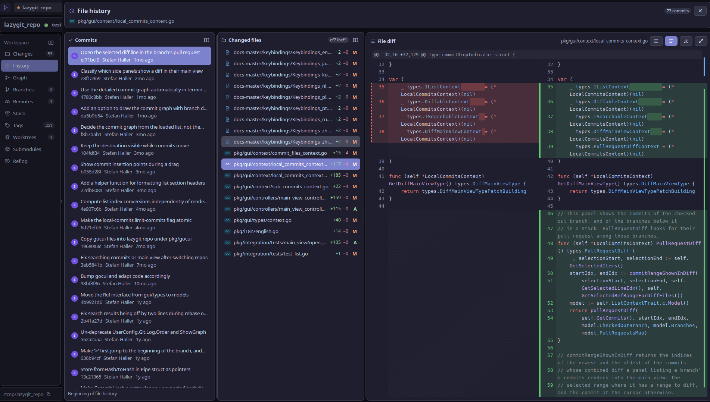

<p align="center">
  
</p>

<h1 align="center">TanGit</h1>

<p align="center"><strong>精确提交，直观查看历史，尽在原生 Git 工作区。</strong></p>
<p align="center">使用 Go 与 MyGo 构建 · macOS · Windows · Linux</p>

<p align="center">
  <a href="https://github.com/FleetingEcho/TanGit/releases">下载</a> ·
  <a href="#主要功能">主要功能</a> ·
  <a href="docs/guide.md#operation-recovery-history-and-assisted-review">操作指南（英文）</a> ·
  <a href="#快速开始">快速开始</a> ·
  <a href="#快捷键">快捷键</a> ·
  <a href="#架构">架构</a> ·
  <a href="README.md">English</a>
</p>

<p align="center">
  <picture>
    <source media="(prefers-color-scheme: dark)" srcset="docs/screenshots/workspace.png">
    <source media="(prefers-color-scheme: light)" srcset="docs/screenshots/workspace_light.png">
    
  </picture>
</p>

<p><strong>截图 · 8 个视图</strong></p>

<table>
  <tr>
    <td width="50%"><a href="docs/screenshots/workspace.png"></a><br><sub>工作区 · 深色</sub></td>
    <td width="50%"><a href="docs/screenshots/workspace_light.png"></a><br><sub>工作区 · 浅色</sub></td>
  </tr>
  <tr>
    <td width="50%"><a href="docs/screenshots/graph_dark.png"></a><br><sub>提交图 · 深色</sub></td>
    <td width="50%"><a href="docs/screenshots/graph_light.png"></a><br><sub>提交图 · 浅色</sub></td>
  </tr>
  <tr>
    <td width="50%"><a href="docs/screenshots/picker.png"></a><br><sub>仓库选择</sub></td>
    <td width="50%"><a href="docs/screenshots/file-history.png"></a><br><sub>文件历史</sub></td>
  </tr>
  <tr>
    <td width="50%"><a href="docs/screenshots/editor.png"></a><br><sub>代码编辑器</sub></td>
    <td width="50%"><a href="docs/screenshots/i18n.png"></a><br><sub>多语言</sub></td>
  </tr>
</table>

## TanGit是什么？

TanGit将Lazygit的 Git 引擎带到了原生桌面界面中，
让键盘操作与可视化工具配合，把复杂的更改看清楚、处理好。

- **把混合修改整理成清晰的提交。** 跨多个差异块选择需要的行，单独暂存、取消暂存或储藏，其余修改保持不动。
- **直观地整理提交历史。** 沿着提交图和文件历史追踪变化，再批量拣选、压缩、修正、丢弃或重排提交。
- **在审查差异的地方解决冲突。** 在 Base、Current、Incoming 和 Result 视图间对照，逐块选择、编辑结果，暂存前还能撤销选择。启用 **Guided** 后可查看随现场更新的操作清单和各版本说明。持久的单文件恢复会保留最初的冲突文件与索引阶段。
- **让开发工具围绕仓库工作。** 切换仓库标签页，使用语法高亮和语言服务器辅助编写代码，在内置终端运行 shell，一键打开配置好的编辑器。
- **把工作区调成顺手的样子。** 调整面板大小、展开详情、按目录浏览文件，还能选择 20 种配色、自定义字体和六种界面语言。

有重要影响的操作会先说明后果并请求确认。受租约保护的强制推送、
支持的撤销与重做，以及引用日志恢复，让更改过程更可控。

## 主要功能

| | 你可以做什么 |
| --- | --- |
| **更改与差异** | 暂存文件或选中的行；查看统一、左右对照、图片及媒体差异；导出补丁。**选择更改**（`m`）把差异块与行选择合在一起：可对当前差异块或选中的行暂存、取消暂存或丢弃，操作前会用绑定仓库状态的补丁重新检查。Change Courier 可将文件预览并复制为另一个工作树的未暂存更改。 |
| **历史与提交图** | 筛选提交、查看文件历史、批量拣选、修改提交信息，以及压缩和重排提交。可查看 Git 实际生成的交互式 **Rebase TODO**，经 CAS 校验后编辑，也可标记完整 SHA 的基点执行 `--onto` 变基。自定义补丁既能应用、导出或传递，也能基于单一来源提交，将修改从原提交移除、移到索引或其他提交，或在来源前后新建提交。 |
| **分支与恢复** | 管理远程仓库、标签、储藏、工作树和子模块；查看引用日志，撤销支持的操作。**Sync stack…** 会冻结并预览逐分支的合并、变基和 ref 更新计划，应用前再次校验，还可按预览时的远端 OID 租约逐分支发布。Safety Journal 与单文件冲突恢复分别保存可重新验证的持久恢复状态。 |
| **协作与自动化** | 通过 GitHub CLI（`gh`）或 GitLab CLI（`glab`）创建拉取请求、查看检查；导出 `format-patch` 系列并应用邮箱补丁。支持持久 Agent 任务、本地 CLI/RPC 和自定义 shell 命令，后台获取与清理策略可配置。 |
| **冲突处理** | 直接读取 Git 的操作类型、ref、SHA 和进度，并按实际状态提供 **Continue**、**Skip**、**Abort**。分组后的 **Hunk**、**View**、**Apply** 控件在宽、窄面板中都能操作冲突导航、版本视图、各方修改和助手入口；只有明确选择 **Mark resolved** 才会暂存解决结果。 |
| **辅助审查** | Conflict Assistant 在克隆的 Result 上建议冲突区域替换；Change Splitter 按原始差异标识分组，并预览由 TanGit 生成的纯索引补丁。两者使用可选且与服务商无关的 `AssistCommand`，建议预览本身不会自动暂存或提交。 |
| **代码工作区** | 使用语法高亮和语言服务器辅助编辑代码，管理文件和标签页，并通过 fzf 快速打开、高级内容搜索和 Markdown 预览提高效率。 |
| **工作区** | 仓库标签页、目录树、可调整大小的面板、可展开的分支与差异页面、终端和外部编辑器。 |
| **工作流入口** | 使用**命令面板**（`Ctrl/Cmd+Shift+P`）搜索当前导航、Git、差异块、冲突、Agent 和自定义命令，也可切换模式：`@` 分支、`#` 提交（粘贴 hash，或按消息、`by:作者`、`branch:` 搜索）、`/` 文件、`~` 最近的仓库、`!` 运行 shell 命令并实时显示输出。选中提交会列出其右键菜单的全部操作。**活动中心**（`Ctrl/Cmd+Shift+A`）汇总所有已打开仓库的命令、安全日志、Agent 任务、传输和通知，其中的**贡献者**视图显示谁提交了多少、最近提交了什么。**概览**集中显示工作区、操作、协作、Agent、贡献者（总数、近期活跃人数、每周提交图、贡献最多的人）和近期活动状态。**命令日志**支持按状态、来源和时间范围筛选，显示成功图标、状态徽章和时间，可展开输出，并在向下滚动时每次加载 20 条记录。 |
| **个性化** | 主题、字体、六种界面语言、可配置的工作区栏目，以及带签名验证的应用内更新。 |

提交操作集中在详情面板和右键菜单中。点击差异的行号即可开始多行选择，
Shift 点击可选择连续范围。

[常用工作流（英文）→](docs/guide.md#common-workflows)

### Git 工作区中的代码编辑器

- **编写和审查代码。** 使用语法高亮、撤销／重做、临时预览与持久标签页、前进／后退导航以及未保存更改提醒。按 `Ctrl/Cmd+S` 保存，按 `Ctrl/Cmd+Shift+S` 全部保存；可在源码旁预览 Markdown，也可直接查看图片，无需切换到其他应用。
- **查找并理解代码。** 通过 fzf 模糊匹配快速打开路径。内容搜索支持区分大小写、全词匹配、正则表达式和包含／排除 glob；结果按文件分组并可逐页加载，点击匹配项即可跳转。可选语言服务器还提供代码补全、悬停文档、诊断和跳转到定义。
- **沿用熟悉的工具。** 可以通过 TanGit 安装受支持的语言服务器、配置自定义语言服务器，或在 ripgrep 与内置 Go 搜索器之间切换。
- **在编辑器中管理文件。** 新建文件和文件夹、重命名或删除，并可通过拖放移动条目。也可将系统文件或文件夹拖放到文件资源管理器的任意位置：本地工作区会复制它们，SSH 工作区会通过 SFTP 上传，并显示字节／条目进度和取消按钮。打开的标签页和未保存缓冲区会跟随重命名与移动，也可以将仓库子文件夹设为工作区根目录。
- **直接通过 SSH 工作。** 在首页或设置中配置 Linux SSH 工作区，支持 Agent、私钥或密码认证。Git、编辑、搜索、终端和递归传输均在远程执行，无需本地镜像或服务器代理。本地条目通过系统文件管理器打开；远程“在文件资源管理器中打开”会在远程桌面以 `DISPLAY=:0` 启动 `Narwhal`。

## 操作恢复与辅助处理

**Changes** 上方的操作卡片来自真实 Git 元数据，可区分合并、变基、带变基的拉取、
`am`、拣选和还原，而不是根据当前分支名称猜测。可用按钮由操作类型和 Git
状态决定；并非每种操作都提供 **Skip**。如有冲突，必须先解决并暂存，
才能执行 **Continue**；TanGit 还会重新核对之前审阅的操作指纹与未合并索引，
避免对已经变化的现场继续操作。

如果需要更明确的操作顺序，可在 **Settings → Behavior → Conflict and hunk
buttons** 中选择第三项 **Guided**；它与 **Icons**、**Icons + labels** 一样会保存为偏好设置。
操作区域会列出 **Read conflict**、**Choose or edit Result**、**Mark resolved**、
**Review staged** 和 **Continue**，并根据当前 Git 状态、所选文件及 Result 显示
**Earlier / Current / Next** 或 **Available**。这些标记表示当前所处位置，并非保存下来的
“已完成”记录，也不会替你解决冲突、暂存或继续操作。若当前文件没有持久恢复记录，
面板会明确说明没有可用恢复，不会凭空出现 **Restore unresolved…** 或 **Retry…** 按钮。
详见[引导式冲突处理（英文）](docs/guide.md#guided-conflict-mode)。

在本地仓库中选择 **Continue** 会先打开 **Continue preflight**。可在 **Settings → Behavior**
中把 **Required check command** 配成 `go test ./...`，再按需把 **Optional check command**
配成 `golangci-lint run`。Required 留空会直接阻止 Continue，Optional 也不会执行；
Required 通过后才会运行 Optional，Optional 留空则记为 skipped。只有 Optional 的状态为
**failed**，且其余检查都通过时，才能明确选择 **Override optional failure and continue**。
取消、现场已变化或无法读取，以及 checkpoint 失败都不能用 override 绕过。这里执行的是
具有当前用户完整权限的可信本地 shell 命令，**不是沙箱**，可以联网和读写文件。SSH 工作区
会禁用 Continue，而不是拿本地命令去检查远程工作树。

命令结束后，TanGit 会比较操作指纹、规范的索引记录，以及已跟踪文件和普通非忽略的
未跟踪文件内容，列出发生变化的路径；检测到内容变化时，必须先成功创建 checkpoint。
被忽略的文件、仓库外的写入和网络副作用不在这次比较范围内。无论是正常继续，还是
选择覆盖 Optional 失败，最后都会重新比较现场，再交给操作驱动按预期指纹执行 CAS。
[拒绝规则与完整示例（英文）→](docs/guide.md#continue-preflight-and-trusted-checks)

**Recovery & checkpoints → Recovery** 按单个文件分别保存最初的冲突工作区内容、
索引阶段和后续状态。恢复会以该路径的 before/after 状态做 CAS 校验，续接持久化的
文件与索引恢复步骤；如果发现同一路径已有较新的修改，就停止覆盖并保留这些工作，
其他路径不参与这项校验。

Conflict Assistant 和 Change Splitter 只有在你主动请求建议时才运行。
`AssistCommand` 留空便不会启动外部 helper。这个命令通过平台 shell 启动，属于
**用户信任的本地 helper，而不是沙箱**，也不是内置模型服务。接受冲突建议只写入
审阅过的 Result；应用某个拆分组是另一步明确操作，只暂存该组，不改工作树，
也不创建提交。来源或所属对话框一旦变化，迟到的预览就不能再应用。

历史编辑要求所有修改来自同一来源提交，并绑定补丁和预期 HEAD；中断后可通过
操作驱动继续。合并提交不能作为来源或目标，根提交不支持在其之前新建提交
（**New commit before original**），`commit.gpgsign=true` 也不受支持。Stack Sync 则逐分支独立发布：
一个分支推送失败，不会回滚已完成的本地更新或其他远端分支，不构成远端事务。

### 示例：完成一次中断的变基

1. 先查看操作类型和当前步骤，再到 **Changes** 打开冲突文件。
2. 对照 **Base**、**Current**、**Incoming**，直接编辑 **Result**，或使用分组后的版本／差异块操作。需要时先预览 Conflict Assistant 的建议，再只接受 Result。
3. 选择 **Mark resolved**，检查暂存差异，并对其余冲突文件重复处理。若需要回到最初的冲突现场，可使用单文件持久恢复。
4. 到 **Rebase TODO** 核对当前与待执行步骤后选择 **Continue**。先查看 Required／Optional 的输出、检查命令造成的文件／索引变更和 checkpoint 结果，再选择 **Continue operation**；只有确实需要接受 Optional 失败时才使用专门的 override。只有当前操作确实提供 **Skip**，且你准备丢弃停下的一步时才使用它；放弃整个操作则选择 **Abort**。
5. 最后检查生成的历史和剩余更改，再继续其他提交。若 CAS 校验失败，应刷新并重新审阅；这不表示 TanGit 覆盖了较新的工作。

[详细操作、约束与助手协议（英文）→](docs/guide.md#operation-recovery-history-and-assisted-review) ·
[大型仓库的刷新行为与实测范围（英文）→](docs/guide.md#large-repositories-and-refresh)

## 快速开始

1. 安装 [Git](https://git-scm.com/)，然后下载 [TanGit 安装包](https://github.com/FleetingEcho/TanGit/releases)。
2. macOS 使用 **DMG**，Windows 使用 **安装程序**，Linux 使用对应架构的 **`.deb` 或压缩包**。
3. 打开本地仓库，点击首页 **打开 SSH** 直接操作远程 Linux 仓库，或选择 **克隆**，通过 HTTPS 或 SSH 地址克隆，查看真实进度、选择分支，并在完成后自动打开。克隆使用现有的 Git 凭据助手或 SSH Agent；SSH 工作区的机密优先保存在操作系统钥匙串中，不可用时仅在当前会话保留。

验证结论只适用于日志中记录的工具版本和环境，不能据此推断所有 Git
版本或 SSH 部署都已通过实测。**Git 2.32 目前尚未验证。**详见
[版本与能力验证范围（英文）](docs/verification.md#version-and-capability-evidence)。

安装 [ripgrep](https://github.com/BurntSushi/ripgrep) 可以加快大型仓库中的编辑器内容搜索。没有 `rg` 时，TanGit 会自动使用内置搜索，并通过 [fzf](https://github.com/junegunn/fzf) 为快速打开的路径和内容搜索结果排序。

可以编辑 **工作区文件夹** 并按回车，或点击文件夹按钮，将仓库中的任意深层子文件夹打开为编辑器根目录。文件资源管理器随后只显示该文件夹及其后代，不再显示祖先或范围外的条目；快速打开和内容搜索也使用相同范围，根级文件创建与拖放会以此文件夹为目标，外部编辑器菜单也会打开此文件夹。尚未提交的输入只是草稿，不会改变当前工作区；点击清除按钮即可恢复整个仓库。可选的包含／排除 glob 默认折叠在 **文件筛选** 中。搜索前会排除常见的生成目录与依赖目录。在 **设置 → 编辑器 → 搜索排除项** 中，可以添加文件夹名称、移除任意默认项、清空列表或恢复默认值。排除项匹配任意层级；`vendor` 等源码目录仍可搜索，除非你主动添加。

切换分支后，文件资源管理器会刷新，未修改的已打开文档会重新加载，进行中的搜索会基于新目录树重新执行。含未保存内容的编辑器缓冲区会保留，并显示来自上一分支的警告，直到你明确保存。

**通过终端打开仓库：**先完成[对应平台的命令配置（英文）](docs/guide.md#open-a-repository-from-the-terminal)，然后运行：

```sh
tangit .
tangit "./包含空格的仓库"
```

命令会立即返回，并复用正在运行的 TanGit 窗口：如果仓库已经打开，就切换到对应标签页；否则新建标签页。
macOS 的命令启动器和 Windows 的 PATH 需要配置一次。详细指南也包含现有安装版本和自定义安装位置的配置方法。

**使用外部编辑器：**在 **设置 → 编辑器** 中选择预设或填写命令。
点击编辑器按钮即可直接打开。Neovim 会在终端中运行；在 macOS 上退出 Neovim 后，
会回到项目目录或文件所在目录的 shell。

## 快捷键

| 按键 | 操作 |
| --- | --- |
| `?` / `F1` | 当前上下文帮助 / 完整快捷键列表 |
| `Tab` / `Shift+Tab`、`F6` / `Shift+F6` | 在控件和面板之间移动 |
| 方向键、`j` / `k` | 在当前聚焦的列表中移动 |
| `Space` | 在“更改”页面暂存或取消暂存，也适用于选中的差异行 |
| `c` / `Ctrl+Enter` | 编写 / 提交更改 |
| `Ctrl+I` | 在“更改”页面预览并应用补丁或 diff |
| `C` | 在首页克隆远程仓库 |
| `Ctrl+B` / `B` | 添加所选提交或历史文件 / 审阅自定义补丁 |
| 历史差异中的 `A` / `Space` | 将当前差异块 / 选中的更改行添加到自定义补丁 |
| `p` / `P` | 拉取 / 推送 |
| `r` | 在历史或提交图中修改提交信息 |
| `z` / `Z` | 撤销 / 重做支持的操作 |
| `Ctrl+Tab` / `Ctrl+Shift+Tab` | 切换仓库标签页 |
| `Ctrl/Cmd+Shift+P` | 在命令面板中搜索并运行命令（`@` 分支、`#` 提交、`/` 文件、`~` 仓库、`!` shell） |
| `Ctrl/Cmd+Shift+A` | 打开活动中心 |
| Changes 差异中的 `m` | 开启“选择更改”：差异块与行操作 |
| `Ctrl+P` / `Ctrl+Shift+F` | 在代码工作区快速打开 / 搜索文件内容 |
| ``Ctrl+` `` / `Ctrl+,` | 终端 / 设置 |

大写字母表示 **Shift + 对应字母键**。Git 快捷键作用于当前聚焦的面板，
文本输入框保留正常输入行为。需要特别留意的操作会先请求确认。
[更多快捷键（英文）→](docs/guide.md#keyboard)

## 架构

TanGit 使用 Go 开发，**MyGo** 负责原生界面渲染，**Lazygit** 提供 Git 命令层。
仓库会话将 Git 操作与仓库数据封装起来，使界面与底层操作分离。

界面负责发起任务并展示刷新的仓库快照。MyGo 的无窗口测试工具可以模拟点击、输入、
键盘焦点移动，并检查渲染后的布局。

## 构建与参与开发

需要 Go **1.27.3** 和 Git，依赖统一声明在 `go.mod` 中。

```sh
git clone https://github.com/FleetingEcho/TanGit.git
cd TanGit
go tool mygo dev      # 开发模式
go tool mygo build    # 构建当前平台的应用
```

[开发与检查（英文）](docs/guide.md#development) ·
[发布构建与签名更新（英文）](docs/guide.md#publishing-signed-updates) ·
[问题反馈](https://github.com/FleetingEcho/TanGit/issues)

---

[MIT 许可证](LICENSE) · 基于 [MyGo](https://github.com/egoist/mygo) 和
[Lazygit](https://github.com/jesseduffield/lazygit) 构建。
