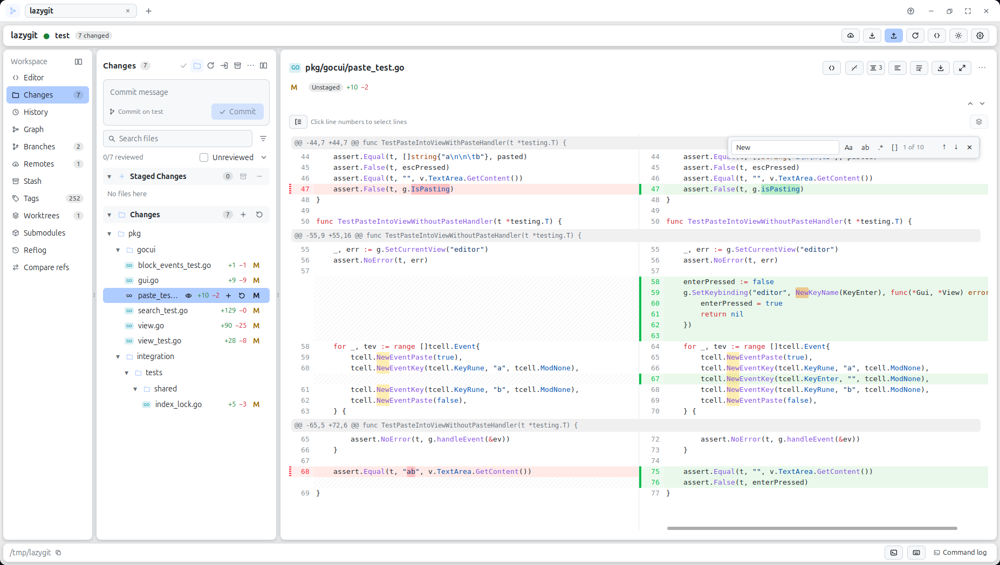
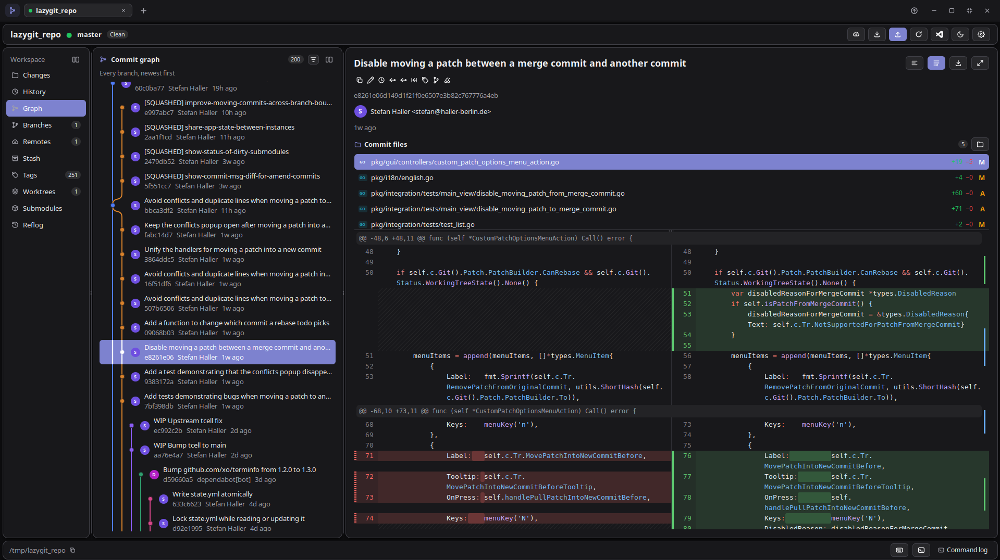
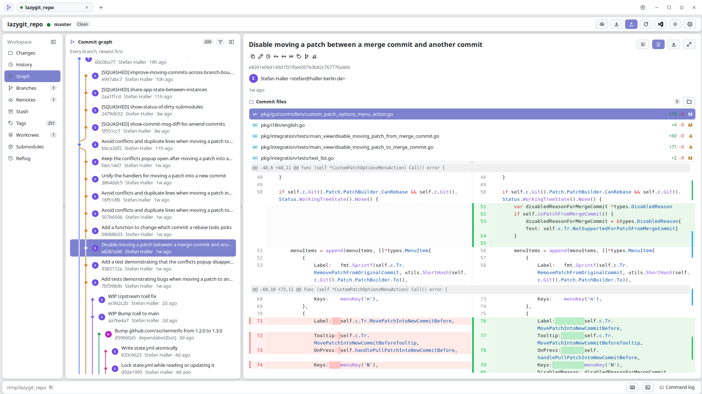
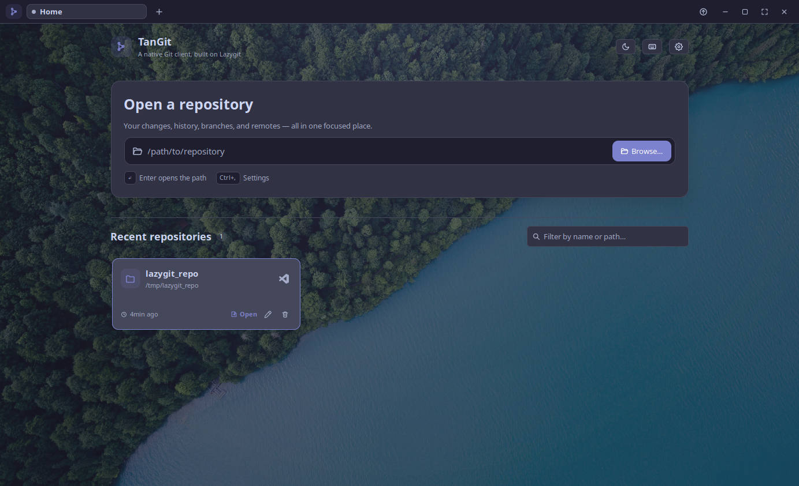
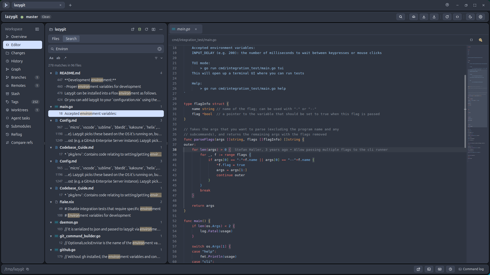
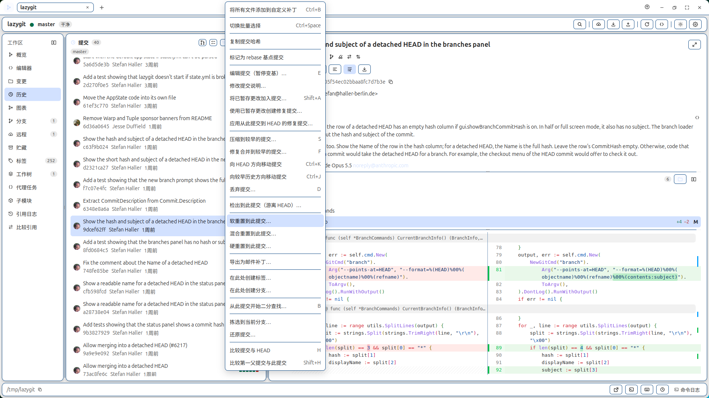

<p align="center">
  
</p>

<h1 align="center">lazygitGo</h1>

<p align="center">
  <strong>原生桌面 Git 客户端：Lazygit 的引擎、可视化的提交历史，以及内置代码编辑器。</strong>
</p>

<p align="center">
  <a href="https://github.com/FleetingEcho/lazygitGo/releases"></a>
  <a href="LICENSE"></a>
  
  
</p>

<p align="center">
  <a href="https://github.com/FleetingEcho/lazygitGo/releases"><b>下载</b></a> ·
  <a href="#安装">安装</a> ·
  <a href="#你可以做什么">功能</a> ·
  <a href="#键盘优先">快捷键</a> ·
  <a href="docs/guide.md">指南（英文）</a> ·
  <a href="README.md">English</a>
</p>

<p align="center">
  <picture>
    <source media="(prefers-color-scheme: dark)" srcset="docs/screenshots/workspace.png">
    <source media="(prefers-color-scheme: light)" srcset="docs/screenshots/workspace_light.png">
    
  </picture>
</p>

## 为什么选择 lazygitGo？

[Lazygit](https://github.com/jesseduffield/lazygit) 之所以快，是因为手不用离开键盘；
而当你需要*看清*一段历史、一处冲突或一份差异时，图形界面更直观。
lazygitGo 两者兼顾：沿用 Lazygit 的 Git 命令层，放进原生窗口，并在真正需要的地方提供可视化工具。

|  |  |
| --- | --- |
| 🎯 **精确提交** | 跨多个差异块，按行暂存、取消暂存、丢弃或储藏，其余修改保持不动。 |
| 🌳 **直观历史** | 沿着提交图和文件历史追踪变化，批量拣选、压缩、修正、丢弃和重排提交。 |
| 🧩 **更安全的冲突处理** | 并排对照 Base、Current、Incoming 和 Result，逐块选择、编辑结果，暂存前还能撤销选择。 |
| 🛟 **内置恢复能力** | 引用日志、持久的安全日志和单文件冲突恢复。有风险的操作会先说明后果并请求确认。 |
| 💻 **一个工作区** | 代码编辑器、搜索、终端和 SSH 工作区，与仓库标签页并排使用。 |

## 你可以做什么

### 准确提交你想提交的内容

- **按行暂存。** 点击差异的行号开始选择，Shift 点击选择连续范围。按 `m` 开启**选择更改**：对当前差异块或选中的行暂存、取消暂存或丢弃。
- 支持**统一、左右对照、图片及媒体差异**、补丁导出，以及 **Apply patch…** 应用外部 `.patch` / `.diff` 文件（`Ctrl+I`）。
- **自定义补丁。** 汇集多个提交和历史文件中的修改，再导出、应用到工作区，或移到其他提交或索引。
- **Change Courier** 预览补丁，并作为未暂存更改复制到另一个工作树，不改写历史。

### 看懂并整理历史

- **提交图与文件历史**，支持筛选、blame 和 bisect（`b`、`g`、`k`、`R`）。
- **批量改写：** 修改信息、压缩、修正、丢弃、重排，暂停并编辑旧提交（`e`），或基于标记的基点执行 `--onto` 变基。
- **Rebase TODO** 显示 Git 实际的交互式待办列表，并通过 CAS 校验后再编辑。
- **Sync stack…** 预览逐分支的合并、变基和 ref 更新计划，校验后可按租约逐分支发布。
- 管理远程仓库、标签、储藏、工作树和子模块；导出或导入 `format-patch` 系列补丁。

### 在审查差异的地方解决冲突

- 四栏 **Base / Current / Incoming / Result** 视图，差异块、版本和 Result 控件会随窄窗口自动调整。
- 操作卡片读取 Git 的真实状态（合并、变基、`am`、拣选、还原），只提供当前确实可用的 **Continue**、**Skip** 和 **Abort**。
- **Guided 模式**提供实时清单：读冲突、选择或编辑 Result、标记已解决、检查暂存、继续。
- **Continue preflight** 可在继续操作前运行你配置的必需和可选检查（例如 `go test ./...`）。
- **持久恢复**保留每个文件最初的冲突内容和索引阶段，发现有较新的修改就拒绝覆盖。
- 可选的 **Conflict Assistant** 和 **Change Splitter** 会调用你配置的 helper 命令。它们只给出建议，不会替你暂存或提交。

### 一眼看清仓库状态

- **概览**是默认首页：接下来该处理什么、工作区与操作状态、PR 检查、Agent 任务和近期活动。
- **贡献者**（可按时间段和分支查看）、**提交热力图**、**代码更改**（新增与删除的行数）和**分支健康**（已合并、陈旧和严重落后的分支）。
- **命令面板**（`Ctrl/Cmd+Shift+P`）可运行任何操作；加前缀可切换模式：`@` 分支、`#` 提交、`/` 文件、`~` 最近的仓库、`!` shell。
- **活动中心**（`Ctrl/Cmd+Shift+A`）汇总所有已打开仓库的命令、安全日志、Agent 任务、传输和通知。
- 可筛选的**命令日志**记录每条已运行的 Git 命令及其输出。

### 不离开 Git，也能写代码

- **编辑器**支持语法高亮、标签页、Markdown 预览、图片查看、随重命名更新的缓冲区，以及可选的**语言服务器**（补全、悬停文档、诊断、跳转到定义、格式化）。
- **搜索。** `Ctrl+P` 通过 fzf 快速打开文件；`Ctrl+Shift+F` 搜索内容，支持区分大小写、全词、正则、包含／排除 glob 和文件夹范围。在 macOS 和 Linux 上，会在后台为仓库建立本地 [Zoekt](https://github.com/sourcegraph/zoekt) 索引，大型仓库中的搜索依然很快；没有索引时依次回退到 ripgrep 和内置扫描器。搜索排除项和索引可在设置中调整。[详情（英文）→](docs/guide.md#code-search-backends-index-and-exclusions)
- **文件管理。** 新建、重命名、删除、拖放，并可把仓库的任意子文件夹打开为工作区根目录。
- **内置终端**可停靠在任意一侧，也可一键启动外部编辑器。
- **SSH 工作区。** Git、编辑、搜索、终端和 SFTP 传输直接在远程 Linux 主机上执行，无需本地镜像，也无需服务器代理。

### 自动化与协作

- 通过 GitHub CLI（`gh`）或 GitLab CLI（`glab`）创建拉取请求、查看检查。
- **Agent 任务**为每个任务提供独立的分支和工作树，状态持久保存并可审查；可通过本地 `lazygitGo agent …` CLI 或 RPC 驱动。详见 [Agent 工作区](docs/agent-workspaces.md)与[自动化](docs/agent-automation.md)（英文）。
- 自定义命令支持 `{{branch}}`、`{{file}}` 等占位符和可选快捷键。
- 可配置的后台获取与清理、20 种配色、自定义字体、六种界面语言，以及带签名验证的应用内更新。

## 截图

<table>
  <tr>
    <td width="50%"><a href="docs/screenshots/workspace.png"></a><br><sub>工作区 · 深色</sub></td>
    <td width="50%"><a href="docs/screenshots/workspace_light.png"></a><br><sub>工作区 · 浅色</sub></td>
  </tr>
  <tr>
    <td width="50%"><a href="docs/screenshots/graph_dark.png"></a><br><sub>提交图 · 深色</sub></td>
    <td width="50%"><a href="docs/screenshots/graph_light.png"></a><br><sub>提交图 · 浅色</sub></td>
  </tr>
  <tr>
    <td width="50%"><a href="docs/screenshots/picker.png"></a><br><sub>仓库选择</sub></td>
    <td width="50%"><a href="docs/screenshots/file-history.png"></a><br><sub>文件历史</sub></td>
  </tr>
  <tr>
    <td width="50%"><a href="docs/screenshots/editor.png"></a><br><sub>代码编辑器</sub></td>
    <td width="50%"><a href="docs/screenshots/i18n.png"></a><br><sub>界面语言</sub></td>
  </tr>
</table>

## 安装

1. 安装 [Git](https://git-scm.com/)。
2. 从 [发布页](https://github.com/FleetingEcho/lazygitGo/releases)下载适合你系统的安装包。

| 系统 | 安装包 |
| --- | --- |
| macOS（通用版） | `.dmg` |
| Windows（AMD64、ARM64） | 安装程序 |
| Linux（AMD64、ARM64） | `.deb` 或压缩包。Debian：`sudo apt install ./lazygitgo_*.deb` |

3. 打开本地仓库；点击 **打开 SSH** 操作远程 Linux 仓库；或在首页点击 **克隆**，通过 HTTPS 或 SSH 地址克隆并查看真实进度。克隆使用你现有的 Git 凭据助手或 SSH Agent。

**从 TanGit 升级？** 在 **设置 → 更新 → 检查更新** 中安装。原有设置、最近的仓库和工作区都会保留。
Debian 用户请安装新的 `.deb`，它会替换 `tangit`。[升级详情（英文）](docs/guide.md#upgrade-from-tangit)

**可选：** 安装 [ripgrep](https://github.com/BurntSushi/ripgrep)，可加快大型仓库中的内容搜索。

### 通过终端打开仓库

```sh
lazygitGo .
lazygitGo "./包含空格的仓库"
```

命令会立即返回，并复用正在运行的窗口：已打开的仓库切换到对应标签页，否则新建标签页。
macOS 和 Windows 需要[一次性配置（英文）](docs/guide.md#open-a-repository-from-the-terminal)。

> **兼容性说明。** 验证结论只适用于日志中记录的 Git 和 SSH 版本。**Git 2.32 目前尚未验证。**
> 详见[版本与能力验证范围（英文）](docs/verification.md#version-and-capability-evidence)。

## 键盘优先

按 `?` 查看当前面板的帮助，按 `F1` 打开可搜索的完整快捷键列表。大写字母表示 **Shift + 字母**。
Git 快捷键作用于当前聚焦的面板，文本输入框保留正常输入。

| 按键 | 操作 |
| --- | --- |
| `Ctrl/Cmd+Shift+P` | 命令面板（`@` `#` `/` `~` `!` 模式） |
| `Ctrl/Cmd+Shift+A` | 活动中心 |
| `Space` | 暂存或取消暂存，也适用于选中的差异行 |
| `c` / `Ctrl+Enter` | 编写 / 提交更改 |
| `p` / `P` | 拉取 / 推送 |
| `z` / `Z` | 撤销 / 重做支持的操作 |
| `r` / `e` | 修改提交信息 / 暂停变基以编辑提交 |
| `m` | 在 Changes 差异中开启“选择更改” |
| `Ctrl+B` / `B` | 加入 / 审阅自定义补丁 |
| `Ctrl+P` / `Ctrl+Shift+F` | 在编辑器中快速打开 / 搜索内容 |
| `Ctrl+Tab` | 下一个仓库标签页 |
| ``Ctrl+` `` / `Ctrl+,` | 终端 / 设置 |
| `:` / `Ctrl+L` | 运行一次性 shell 命令 / 命令日志 |

[全部快捷键（英文）→](docs/guide.md#keyboard)

## 安全设计

- 有重要影响的操作会先说明后果并请求确认；强制推送使用租约保护。
- 历史编辑与恢复都使用 **CAS（比较并交换）** 校验：现场已变化时会拒绝执行，而不是覆盖较新的工作。
- 检查命令和 `AssistCommand` 都是**用户信任的本地命令，不是沙箱**；未经你配置，不会运行任何命令。

详见[操作恢复、历史与辅助审查（英文）](docs/guide.md#operation-recovery-history-and-assisted-review)。

## 文档

| | |
| --- | --- |
| [指南](docs/guide.md) | 常用工作流、命令面板、概览、恢复、快捷键、开发（英文） |
| [Agent 工作区](docs/agent-workspaces.md) · [自动化](docs/agent-automation.md) | 独立的任务工作树与本地 CLI/RPC（英文） |
| [验证说明](docs/verification.md) | CI 矩阵、已验证的 Git 版本及其范围（英文） |
| [性能](docs/performance.md) | 大型仓库的刷新行为与实测数据（英文） |
| [发布说明](docs/releases/) | 各版本的变化（英文） |

## 从源码构建

需要 Go **1.27.3** 和 Git。Linux 安装包依赖 GTK 3 与 AppIndicator。

```sh
git clone https://github.com/FleetingEcho/lazygitGo.git
cd lazygitGo
go tool mygo dev      # 开发模式
go tool mygo build    # 在 macOS 或 Linux 上构建
bash scripts/build-windows.sh windows/amd64   # 构建 Windows 安装包
```

提交拉取请求之前：

```sh
gofmt -l . && go vet ./... && go tool mygo vet . && CGO_ENABLED=0 go test ./...
```

新增的界面文字需用 `tr(...)` 包裹，并在 `internal/app/i18n*.go` 的每个语言目录中补充翻译。
详见[开发](docs/guide.md#development)与[发布签名更新](docs/guide.md#publishing-signed-updates)（英文）。

**架构概览：** 应用使用 Go 开发，由 [MyGo](https://github.com/egoist/mygo) 渲染原生界面，
Lazygit 提供 Git 命令层。界面负责发起任务并展示仓库快照；MyGo 的无窗口测试工具可以模拟点击、输入、焦点移动，并检查布局。

---

<p align="center">
  <a href="LICENSE">MIT 许可证</a> · 基于 <a href="https://github.com/egoist/mygo">MyGo</a> 和 <a href="https://github.com/jesseduffield/lazygit">Lazygit</a> 构建 ·
  <a href="https://github.com/FleetingEcho/lazygitGo/issues">问题反馈</a>
</p>
