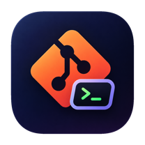
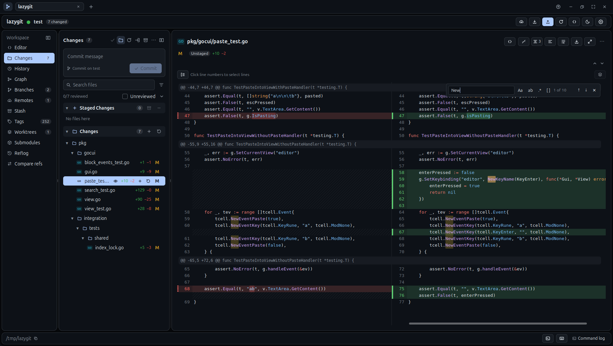
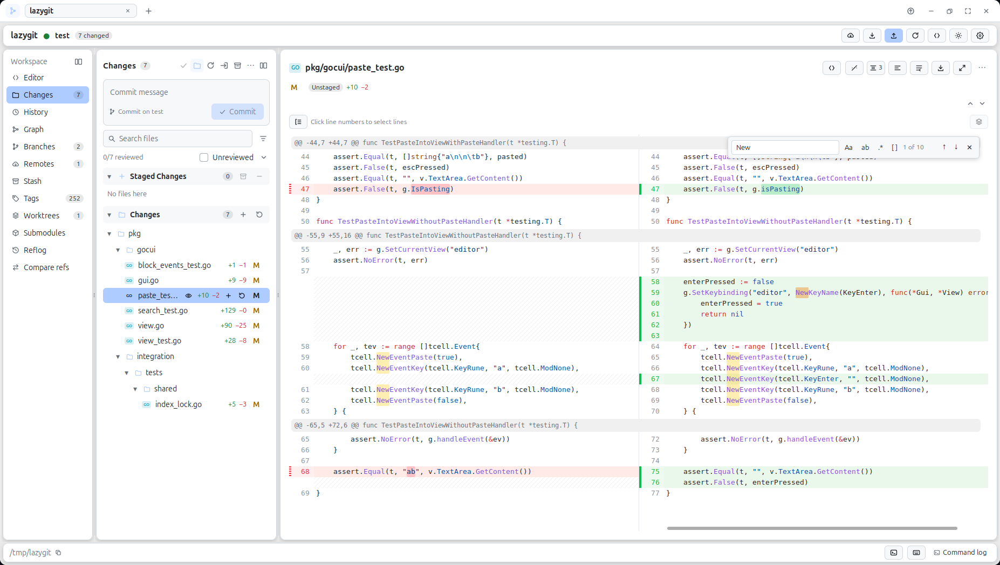
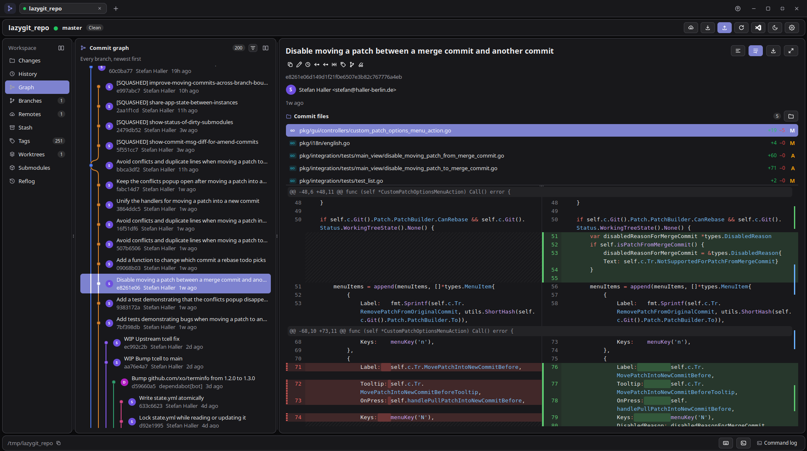
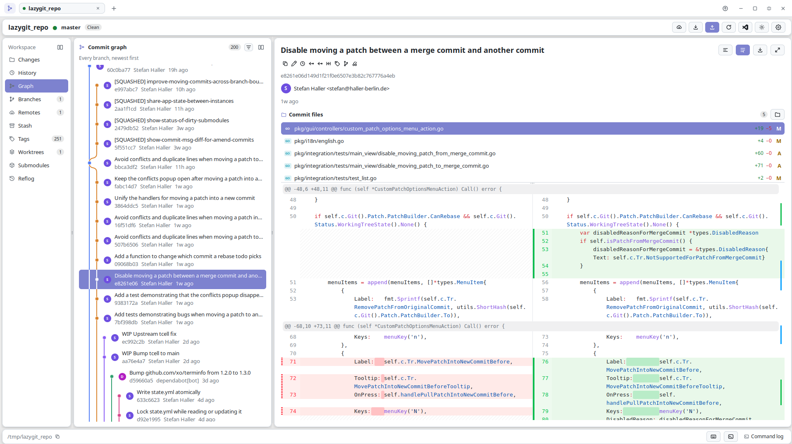
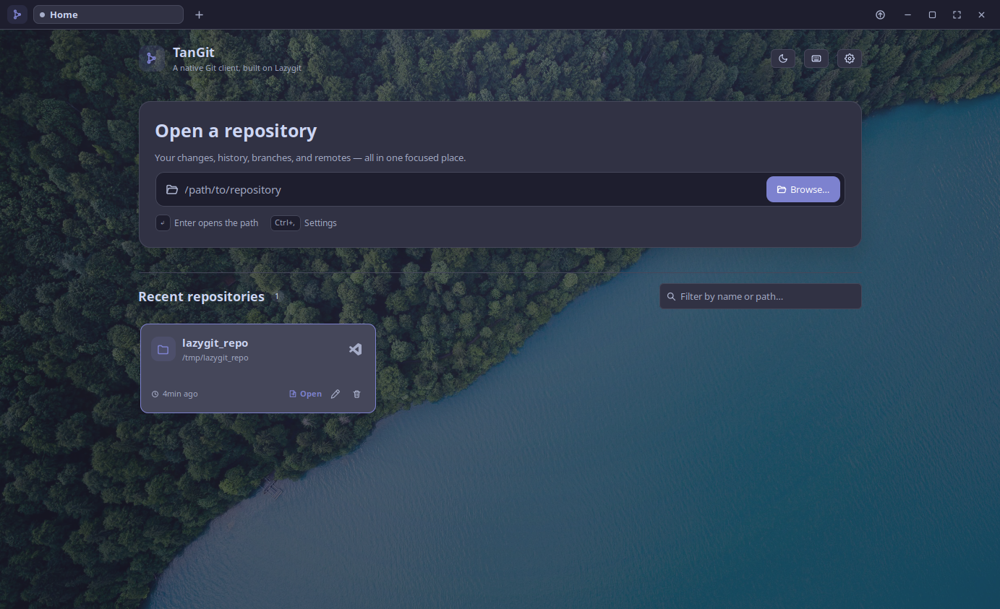
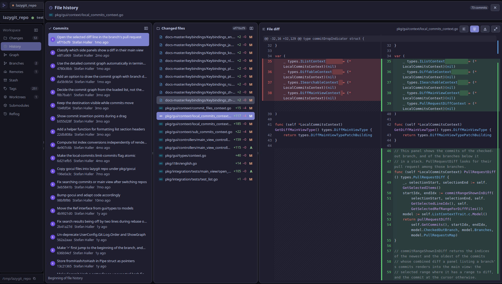

<p align="center">
  
</p>

<h1 align="center">TanGit</h1>

<p align="center"><strong>精确提交，直观查看历史，尽在原生 Git 工作区。</strong></p>
<p align="center">使用 Go 与 MyGo 构建 · macOS · Windows · Linux</p>

<p align="center">
  <a href="https://github.com/FleetingEcho/TanGit/releases">下载</a> ·
  <a href="#主要功能">主要功能</a> ·
  <a href="#快速开始">快速开始</a> ·
  <a href="#快捷键">快捷键</a> ·
  <a href="#架构">架构</a> ·
  <a href="README.md">English</a>
</p>

<p align="center">
  <picture>
    <source media="(prefers-color-scheme: dark)" srcset="docs/screenshots/workspace.png">
    <source media="(prefers-color-scheme: light)" srcset="docs/screenshots/workspace_light.png">
    
  </picture>
</p>

<details>
<summary><strong>查看全部截图 · 6 个视图</strong></summary>

<table>
  <tr>
    <td width="50%"><a href="docs/screenshots/workspace.png"></a><br><sub>工作区 · 深色</sub></td>
    <td width="50%"><a href="docs/screenshots/workspace_light.png"></a><br><sub>工作区 · 浅色</sub></td>
  </tr>
  <tr>
    <td width="50%"><a href="docs/screenshots/graph_dark.png"></a><br><sub>提交图 · 深色</sub></td>
    <td width="50%"><a href="docs/screenshots/graph_light.png"></a><br><sub>提交图 · 浅色</sub></td>
  </tr>
  <tr>
    <td width="50%"><a href="docs/screenshots/picker.png"></a><br><sub>仓库选择</sub></td>
    <td width="50%"><a href="docs/screenshots/file-history.png"></a><br><sub>文件历史</sub></td>
  </tr>
</table>
</details>

## TanGit是什么？

TanGit将Lazygit的 Git 引擎带到了原生桌面界面中，
让键盘操作与可视化工具配合，把复杂的更改看清楚、处理好。

- **把混合修改整理成清晰的提交。** 跨多个差异块选择需要的行，单独暂存、取消暂存或储藏，其余修改保持不动。
- **直观地整理提交历史。** 沿着提交图和文件历史追踪变化，再批量拣选、压缩、修正、丢弃或重排提交。
- **在审查差异的地方解决冲突。** 对照共同祖先、当前和传入版本，逐块选择、编辑结果，暂存前还能撤销选择。
- **让开发工具围绕仓库工作。** 切换仓库标签页，使用语法高亮和语言服务器辅助编写代码，在内置终端运行 shell，一键打开配置好的编辑器。
- **把工作区调成顺手的样子。** 调整面板大小、展开详情、按目录浏览文件，还能选择 20 种配色、自定义字体和六种界面语言。

有重要影响的操作会先说明后果并请求确认。受租约保护的强制推送、
支持的撤销与重做，以及引用日志恢复，让更改过程更可控。

## 主要功能

| | 你可以做什么 |
| --- | --- |
| **更改与差异** | 暂存文件或选中的行；查看统一、左右对照、图片及媒体差异；导出补丁。 |
| **历史与提交图** | 筛选提交、查看文件历史、批量拣选、修改提交信息，以及压缩和重排提交。 |
| **分支与恢复** | 管理远程仓库、标签、储藏、工作树和子模块；查看引用日志，撤销支持的操作。 |
| **冲突处理** | 对照共同祖先、当前和传入版本；按块选择、编辑合并结果，再暂存解决后的文件。 |
| **代码工作区** | 使用语法高亮和语言服务器辅助编辑代码，管理文件和标签页，并通过 fzf 快速打开、高级内容搜索和 Markdown 预览提高效率。 |
| **工作区** | 仓库标签页、目录树、可调整大小的面板、可展开的分支与差异页面、终端和外部编辑器。 |
| **个性化** | 主题、字体、六种界面语言、可配置的工作区栏目，以及带签名验证的应用内更新。 |

提交操作集中在详情面板和右键菜单中。点击差异的行号即可开始多行选择，
Shift 点击可选择连续范围。

[常用工作流（英文）→](docs/guide.md#common-workflows)

### Git 工作区中的代码编辑器

- **编写和审查代码。** 使用语法高亮、撤销／重做、临时预览与持久标签页、前进／后退导航以及未保存更改提醒。按 `Ctrl/Cmd+S` 保存，按 `Ctrl/Cmd+Shift+S` 全部保存；可在源码旁预览 Markdown，也可直接查看图片，无需切换到其他应用。
- **查找并理解代码。** 通过 fzf 模糊匹配快速打开路径。内容搜索支持区分大小写、全词匹配、正则表达式和包含／排除 glob；结果按文件分组并可逐页加载，点击匹配项即可跳转。可选语言服务器还提供代码补全、悬停文档、诊断和跳转到定义。
- **沿用熟悉的工具。** 可以通过 TanGit 安装受支持的语言服务器、配置自定义语言服务器，或在 ripgrep 与内置 Go 搜索器之间切换。
- **在编辑器中管理文件。** 新建文件和文件夹、重命名或删除，并可通过拖放移动条目。打开的标签页和未保存缓冲区会跟随重命名与移动，也可以将仓库子文件夹设为工作区根目录。

## 快速开始

1. 安装 [Git](https://git-scm.com/)，然后下载 [TanGit 安装包](https://github.com/FleetingEcho/TanGit/releases)。
2. macOS 使用 **DMG**，Windows 使用 **安装程序**，Linux 使用对应架构的 **`.deb` 或压缩包**。
3. 打开仓库，审查更改，暂存需要的内容，然后提交。

安装 [ripgrep](https://github.com/BurntSushi/ripgrep) 可以加快大型仓库中的编辑器内容搜索。没有 `rg` 时，TanGit 会自动使用内置搜索，并通过 [fzf](https://github.com/junegunn/fzf) 为快速打开的路径和内容搜索结果排序。

可以编辑 **工作区文件夹** 并按回车，或点击文件夹按钮，将仓库中的任意深层子文件夹打开为编辑器根目录。文件资源管理器随后只显示该文件夹及其后代，不再显示祖先或范围外的条目；快速打开和内容搜索也使用相同范围，根级文件创建与拖放会以此文件夹为目标，外部编辑器菜单也会打开此文件夹。尚未提交的输入只是草稿，不会改变当前工作区；点击清除按钮即可恢复整个仓库。可选的包含／排除 glob 默认折叠在 **文件筛选** 中。搜索前会排除常见的生成目录与依赖目录。在 **设置 → 编辑器 → 搜索排除项** 中，可以添加文件夹名称、移除任意默认项、清空列表或恢复默认值。排除项匹配任意层级；`vendor` 等源码目录仍可搜索，除非你主动添加。

切换分支后，文件资源管理器会刷新，未修改的已打开文档会重新加载，进行中的搜索会基于新目录树重新执行。含未保存内容的编辑器缓冲区会保留，并显示来自上一分支的警告，直到你明确保存。

**通过终端打开仓库：**先完成[对应平台的命令配置（英文）](docs/guide.md#open-a-repository-from-the-terminal)，然后运行：

```sh
tangit .
tangit "./包含空格的仓库"
```

macOS 的命令启动器和 Windows 的 PATH 需要配置一次。
详细指南也包含现有安装版本和自定义安装位置的配置方法。

**使用外部编辑器：**在 **设置 → 编辑器** 中选择预设或填写命令。
点击编辑器按钮即可直接打开。Neovim 会在终端中运行；在 macOS 上退出 Neovim 后，
会回到项目目录或文件所在目录的 shell。

## 快捷键

| 按键 | 操作 |
| --- | --- |
| `?` / `F1` | 当前上下文帮助 / 完整快捷键列表 |
| `Tab` / `Shift+Tab`、`F6` / `Shift+F6` | 在控件和面板之间移动 |
| 方向键、`j` / `k` | 在当前聚焦的列表中移动 |
| `Space` | 在“更改”页面暂存或取消暂存，也适用于选中的差异行 |
| `c` / `Ctrl+Enter` | 编写 / 提交更改 |
| `p` / `P` | 拉取 / 推送 |
| `r` | 在历史或提交图中修改提交信息 |
| `z` / `Z` | 撤销 / 重做支持的操作 |
| `Ctrl+Tab` / `Ctrl+Shift+Tab` | 切换仓库标签页 |
| `Ctrl+P` / `Ctrl+Shift+F` | 在代码工作区快速打开 / 搜索文件内容 |
| ``Ctrl+` `` / `Ctrl+,` | 终端 / 设置 |

大写字母表示 **Shift + 对应字母键**。Git 快捷键作用于当前聚焦的面板，
文本输入框保留正常输入行为。需要特别留意的操作会先请求确认。
[更多快捷键（英文）→](docs/guide.md#keyboard)

## 架构

TanGit 使用 Go 开发，**MyGo** 负责原生界面渲染，**Lazygit** 提供 Git 命令层。
仓库会话将 Git 操作与仓库数据封装起来，使界面与底层操作分离。

界面负责发起任务并展示刷新的仓库快照。MyGo 的无窗口测试工具可以模拟点击、输入、
键盘焦点移动，并检查渲染后的布局。

## 构建与参与开发

需要 Go **1.27.3** 和 Git，依赖统一声明在 `go.mod` 中。

```sh
git clone https://github.com/FleetingEcho/TanGit.git
cd TanGit
go tool mygo dev      # 开发模式
go tool mygo build    # 构建当前平台的应用
```

[开发与检查（英文）](docs/guide.md#development) ·
[发布构建与签名更新（英文）](docs/guide.md#publishing-signed-updates) ·
[问题反馈](https://github.com/FleetingEcho/TanGit/issues)

---

[MIT 许可证](LICENSE) · 基于 [MyGo](https://github.com/egoist/mygo) 和
[Lazygit](https://github.com/jesseduffield/lazygit) 构建。
