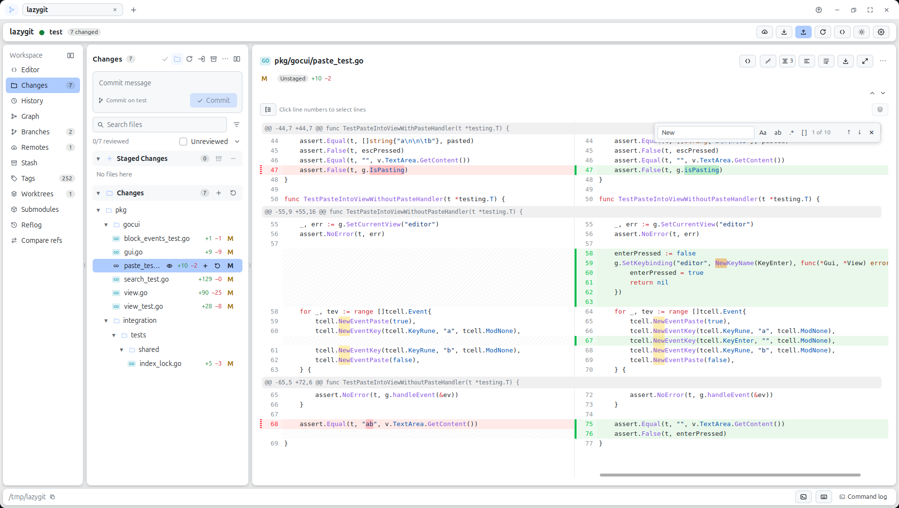
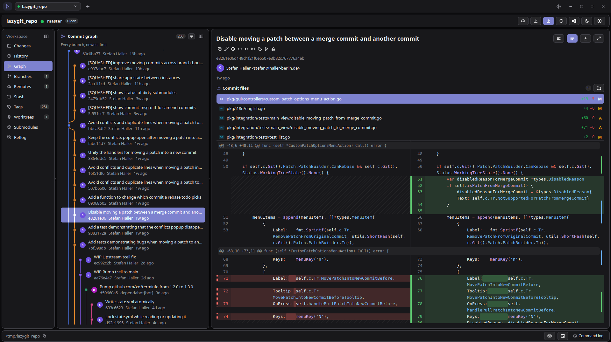
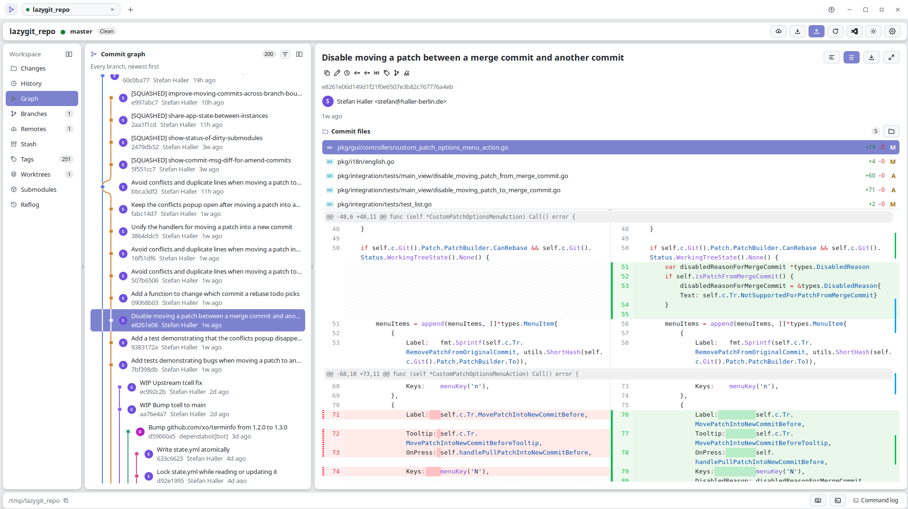
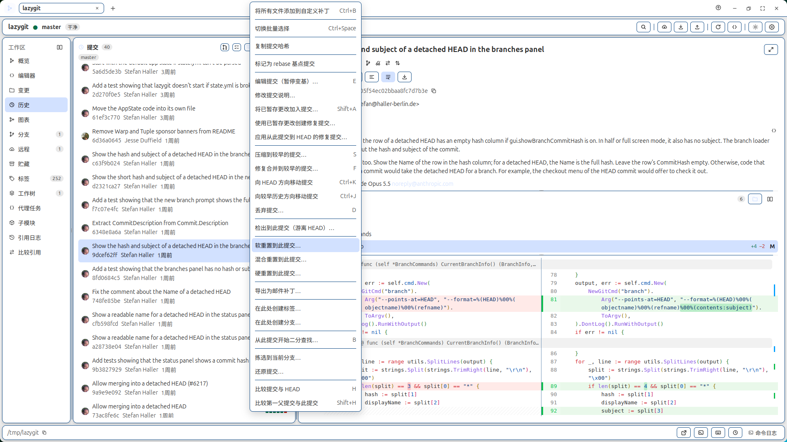

<p align="center">
  
</p>

<h1 align="center">TanGit</h1>

<p align="center"><strong>Precise commits. Visual history. A native Git workspace.</strong></p>
<p align="center">Built with Go and MyGo · macOS · Windows · Linux</p>

<p align="center">
  <a href="https://github.com/FleetingEcho/TanGit/releases">Download</a> ·
  <a href="#features">Features</a> ·
  <a href="docs/guide.md#operation-recovery-history-and-assisted-review">Workflow guide</a> ·
  <a href="#get-started">Get started</a> ·
  <a href="#keyboard-shortcuts">Shortcuts</a> ·
  <a href="#architecture">Architecture</a> ·
  <a href="README-CN.md">简体中文</a>
</p>

<p align="center">
  <picture>
    <source media="(prefers-color-scheme: dark)" srcset="docs/screenshots/workspace.png">
    <source media="(prefers-color-scheme: light)" srcset="docs/screenshots/workspace_light.png">
    
  </picture>
</p>

<p><strong>Screenshot gallery · 8 views</strong></p>

<table>
  <tr>
    <td width="50%"><a href="docs/screenshots/workspace.png"></a><br><sub>Workspace · Dark</sub></td>
    <td width="50%"><a href="docs/screenshots/workspace_light.png"></a><br><sub>Workspace · Light</sub></td>
  </tr>
  <tr>
    <td width="50%"><a href="docs/screenshots/graph_dark.png"></a><br><sub>Commit graph · Dark</sub></td>
    <td width="50%"><a href="docs/screenshots/graph_light.png"></a><br><sub>Commit graph · Light</sub></td>
  </tr>
  <tr>
    <td width="50%"><a href="docs/screenshots/picker.png"></a><br><sub>Repository picker</sub></td>
    <td width="50%"><a href="docs/screenshots/file-history.png"></a><br><sub>File history</sub></td>
  </tr>
  <tr>
    <td width="50%"><a href="docs/screenshots/editor.png"></a><br><sub>Code editor</sub></td>
    <td width="50%"><a href="docs/screenshots/i18n.png"></a><br><sub>Multiple Languages</sub></td>
  </tr>
</table>

## What is TanGit?

TanGit brings Lazygit's Git engine into a native desktop interface, with
keyboard navigation and visual tools for the work that needs a closer look.

- **Turn mixed edits into clean commits.** Stage, unstage, or stash selected lines across separate hunks, keeping the rest of your changes untouched.
- **Shape history visually.** Follow the commit graph and file history, then batch cherry-pick, squash, fix up, drop, or reorder commits.
- **Resolve conflicts in place.** Compare Base, Current, Incoming, and Result views; choose individual hunks, edit the result, and undo a choice before staging. Enable **Guided** for a live resolution checklist and stage-specific help. Durable per-file recovery preserves the original unresolved file and index stages.
- **Keep your development tools together.** Switch repository tabs, edit code with syntax highlighting and language-server assistance, run a shell in the built-in terminal, and open your configured editor with one click.
- **Make the workspace yours.** Resize and expand panels, browse directory trees, and choose from 20 palettes, custom fonts, and six interface languages.

Confirmations explain consequential actions. Force push with lease, eligible
undo/redo operations, and reflog recovery help you manage changes deliberately.

## Features

| | What you can do |
| --- | --- |
| **Changes & diffs** | Stage files or selected lines; review unified, side-by-side, image, and media diffs; export patches. Stage, unstage, or discard the current textual hunk from its Changes toolbar using a repository-state-checked patch. Use Change Courier to preview and copy files, hunks, or lines to another worktree as unstaged changes. |
| **History & graph** | Filter commits, inspect file history, cherry-pick batches, reword, squash, and reorder commits. Preview Git's real interactive **Rebase TODO**, edit it with compare-and-swap checks, or mark a full-SHA base for a targeted `--onto` rebase. Collect a Custom Patch to apply or export, or use its single-source history actions to remove changes, move them to the index or another commit, or create a commit before/after the source. |
| **Branches & recovery** | Manage remotes, tags, stashes, worktrees, and submodules; inspect the reflog and undo eligible operations. **Sync stack…** previews frozen per-branch merge/rebase/update-ref plans, validates the plan before applying it, and optionally publishes each branch with its preview-OID lease. Safety Journal and per-file conflict recovery retain durable, revalidated recovery state. |
| **Collaboration & automation** | Create pull requests and view checks with **GitHub CLI** (`gh`) or **GitLab CLI** (`glab`); export `format-patch` series and apply mailbox patches. Use durable Agent tasks and local CLI/RPC automation, or add custom shell commands. Background fetching and pruning are configurable. |
| **Conflict resolution** | Read Git's live operation type, refs, SHAs, and progress; use the supported **Continue**, **Skip**, and **Abort** actions. Grouped **Hunk**, **View**, and **Apply** controls keep conflict navigation, stage views, side choices, and assistant access reachable in wide or compact layouts. **Mark resolved** stages only when you choose it. |
| **Assisted review** | Conflict Assistant proposes region substitutions on a cloned Result. Change Splitter groups original diff identities and previews TanGit-generated, index-only patches. Both use an optional, provider-neutral `AssistCommand`; neither suggestion preview stages or commits automatically. |
| **Editor workspace** | Edit with syntax highlighting and language-server assistance; manage files and tabs; use fzf Quick Open, advanced content search, and Markdown preview. |
| **Your workspace** | Repository tabs, directory trees, resizable panels, expanded branch/diff views, a terminal, and external editors. |
| **Your preferences** | Themes, fonts, six interface languages, configurable visible sections, and signed in-app updates. |

Commit actions live in detail panels and right-click menus. Click a diff line
number to start multiple-line selection; Shift-click selects a range.

[Common workflows →](docs/guide.md#common-workflows)

### A code editor inside your Git workspace

- **Write and review code.** Use syntax highlighting, undo/redo, temporary previews and persistent tabs, back/forward navigation, and unsaved-change prompts. Save with `Ctrl/Cmd+S`, save all with `Ctrl/Cmd+Shift+S`, preview Markdown beside its source, and inspect images without another app.
- **Find and understand code.** Open paths with fuzzy fzf matching. Search by case, whole word, or regular expression; add include/exclude globs; see the complete grouped results after a responsive first page; and jump directly to a match. Optional language servers add completion, hover documentation, diagnostics, go-to-definition, and right-click document or selection formatting.
- **Use your existing tools.** Install a supported language server through TanGit, configure a custom one, or switch the search backend between ripgrep and the built-in Go scanner. Configure user-installed formatter commands per language in **Settings → Editor**; external commands such as `gofmt` and `prettier --stdin-filepath {{file}}` read source from stdin and replace it with stdout.
- **Manage files without leaving Editor.** Create files and folders, rename or delete them, and drag items between folders. Drop native files and folders anywhere in the Explorer to copy them into a local workspace or upload them over SFTP, with byte/item progress and cancellation. Open tabs and unsaved buffers follow renames and moves, and a repository subfolder can become the workspace root.
- **Work directly over SSH.** Configure Linux SSH workspaces from Home or Settings with agent, private-key, or password authentication. Git, editing, search, terminals, and recursive transfers run remotely without a mirror or server agent. Local items open in the host file manager; remote **Open in explorer** launches `Narwhal` on the remote desktop (`DISPLAY=:0`).

## Recovery and assisted workflows

The operation card above **Changes** describes the actual interrupted merge,
rebase, pull-with-rebase, `am`, cherry-pick, or revert—not an operation guessed
from the visible branch. The operation type and Git state determine which of
**Continue**, **Skip**, and **Abort** is available. Any conflicts must be
resolved and staged before Continue, which revalidates the reviewed operation
fingerprint and unmerged index instead of acting on a stale card.

For guided resolution, choose **Settings → Behavior → Conflict and hunk
buttons → Guided**, the third saved presentation alongside **Icons** and
**Icons + labels**. The operation area lists **Read conflict**, **Choose or
edit Result**, **Mark resolved**, **Review staged**, and **Continue** with
live **Earlier / Current / Next** (or **Available**) positions. Those labels
come from the current Git state, selected file, and Result; they are not saved
completion ticks and do not resolve, stage, or continue automatically. If the
selected file has no durable recovery record, the panel says so and does not
offer a fictitious **Restore unresolved…** or **Retry…** action. See the
[guided workflow](docs/guide.md#guided-conflict-mode).

On a local repository, **Continue** opens **Continue preflight**. Configure a
**Required check command** such as `go test ./...` and, optionally, an
**Optional check command** such as `golangci-lint run` under **Settings →
Behavior**. A blank Required command blocks Continue and Optional does not
run; Required must pass before Optional runs. A blank Optional command is
skipped. Only an Optional **failed** result can be explicitly overridden with
**Override optional failure and continue**, after every other gate passes.
Cancellation, stale or unreadable source state, and checkpoint failure have no
override. These are fully trusted local shell commands with your permissions,
network access, and filesystem access—**not a sandbox**. Continue is disabled
in SSH workspaces rather than running local commands against a remote
checkout.

After the commands, TanGit compares the operation fingerprint, canonical index
records, and tracked plus ordinary non-ignored untracked file content. It
shows changed paths and requires a checkpoint for detected content changes.
Ignored files, writes outside the checkout, and network effects are outside
that comparison. Both ordinary approval and an Optional override perform a
fresh comparison before the operation driver's expected-fingerprint CAS.
[Preflight rules and an example →](docs/guide.md#continue-preflight-and-trusted-checks)

**Recovery & checkpoints → Recovery** stores one file's original unresolved
worktree bytes and index stages separately from its later state. Restore uses
per-path before/after compare-and-swap checks and resumes its durable worktree
and index steps. Newer work on that path stops restoration and is preserved;
unrelated files are not part of the check.

Conflict Assistant and Change Splitter run only after an explicit suggestion
request. An empty `AssistCommand` means no external helper runs. The command is
a user-trusted local helper launched through the platform shell, **not a
sandbox** and not a built-in model service. Accepting conflict advice writes
only the reviewed Result; applying a split group is a separate action that
stages that group without changing the working tree or creating a commit.
Late previews are invalidated when their source or owning dialog changes.

History edits require one source commit, an immutable patch, and the expected
HEAD. They can resume through the operation driver, but do not support merge
sources/destinations, **New commit before original** on a root commit, or
`commit.gpgsign=true`. Stack Sync publishes branches independently: one failed
push does not roll back local updates or other remote branches, and there is no
remote stack transaction.

### Example: finish an interrupted rebase

1. Read the operation type and current step, then open a conflict in **Changes**.
2. Compare **Base**, **Current**, and **Incoming**; edit **Result** directly or use the grouped side/hunk actions. Optionally preview Conflict Assistant suggestions before accepting Result only.
3. Choose **Mark resolved**, review the staged diff, and repeat for every conflicted file. Use durable conflict recovery if you need the original unresolved file and stages.
4. In **Rebase TODO**, check the current and pending steps, then choose **Continue**. Review Required/Optional output, source changes, and the checkpoint result before **Continue operation**; use the explicit Optional override only when appropriate. Choose **Skip** only if that operation offers it and you intend to discard the stopped step; **Abort** is the separate abandon path.
5. Review the resulting history and ordinary Changes before committing anything else. A CAS mismatch means refresh and review again, not that newer work was overwritten.

[Detailed workflows, constraints, and assistant protocol →](docs/guide.md#operation-recovery-history-and-assisted-review) ·
[Large-repository refresh behavior and measurements →](docs/guide.md#large-repositories-and-refresh)

## Get started

1. Install [Git](https://git-scm.com/) and download a [TanGit release](https://github.com/FleetingEcho/TanGit/releases).
2. Use the **DMG** on macOS, the **setup executable** on Windows, or the matching **`.deb` / archive** on Linux.
3. Open a local repository, choose **Open SSH** to work directly in a remote Linux repository, or choose **Clone** on Home to clone an HTTPS or SSH URL with real progress, optional branch selection, and automatic opening. Cloning uses your existing Git credential helpers or SSH agent; direct SSH profiles keep secrets in the OS keychain when available, with session-only fallback.

Verification is tied to the tool versions and environments recorded in its logs;
it is not evidence for every Git release or SSH deployment. **Git 2.32 has not
been verified.** See [version and capability evidence](docs/verification.md#version-and-capability-evidence).

Install [ripgrep](https://github.com/BurntSushi/ripgrep) for faster Editor content searches in large repositories. TanGit uses its built-in search when `rg` is unavailable and ranks Quick Open paths and content results with [fzf](https://github.com/junegunn/fzf).

Edit **Workspace folder** and press Enter, or use its folder button, to open a repository subfolder as the Editor root. The Explorer then lists only that folder and its descendants (without ancestor or outside rows), Quick Open and content search use the same scope, root-level file creation or drops target the opened folder, and the external-editor menu opens that folder too. Unsubmitted text remains a draft and does not change the workspace; the clear button restores the entire repository. Optional include/exclude globs stay collapsed under **File filters**. Common generated and dependency folders are excluded before searching. In **Settings → Editor → Search exclusions**, add folder names, remove any default, clear the list, or restore the defaults. Exclusions match at any depth; source folders such as `vendor` remain searchable unless you add them.

Changing branches refreshes the Explorer, reloads clean open documents, and reruns active searches against the new tree. Unsaved editor buffers remain open with a previous-branch warning until you explicitly save them.

**From the terminal**, after [setting up the command for your platform](docs/guide.md#open-a-repository-from-the-terminal):

```sh
tangit .
tangit "./repository with spaces"
```

The command returns immediately and reuses a running TanGit window, selecting
an existing repository tab or opening a new one. The macOS launcher and Windows
PATH need one-time setup. The guide includes instructions for existing
installations and custom app locations.

**From your editor workflow:** choose a preset or command in **Settings → Editor**.
Editor buttons launch it directly. Neovim opens in a terminal; on macOS,
quitting Neovim returns to the shell in the project or file's directory.

## Keyboard shortcuts

| Keys | Action |
| --- | --- |
| `?` / `F1` | Current-context help / complete shortcut reference |
| `Tab` / `Shift+Tab`, `F6` / `Shift+F6` | Move between controls and panels |
| Arrows, `j` / `k` | Navigate the focused list |
| `Space` | Stage or unstage in Changes, including selected diff lines |
| `c` / `Ctrl+Enter` | Compose / submit a commit |
| `Ctrl+I` | Preview and apply a patch or diff in Changes |
| `C` | Clone a remote repository on Home |
| `Ctrl+B` / `B` | Add the chosen commit or historical file / review Custom Patch |
| `A` / `Space` in a historical diff | Add the current hunk / selected changed lines to Custom Patch |
| `p` / `P` | Pull / push |
| `r` / `e` | Reword / pause a rebase to edit a commit |
| `b` | Start a bisect, or mark the current test as bad; `g` good, `k` skip, `R` reset |
| `z` / `Z` | Undo / redo eligible operations |
| `Ctrl+Tab` / `Ctrl+Shift+Tab` | Switch repository tabs |
| `Ctrl+P` / `Ctrl+Shift+F` | Quick open / workspace content search in Editor |
| ``Ctrl+` `` / `Ctrl+,` | Terminal / Settings |
| `:` / `Ctrl+L` | Run a one-off shell command / command log |

Uppercase letters mean **Shift + letter**. Git shortcuts follow the focused
panel; text fields retain normal typing. Attention-requiring actions ask for
confirmation. [More shortcuts →](docs/guide.md#keyboard)

## Architecture

TanGit is a Go application. **MyGo** renders the native UI, and **Lazygit**
provides the Git command layer. Repository sessions keep Git operations and
repository data separate from the views.

Views schedule work and display refreshed repository snapshots. MyGo's
headless tester exercises clicks, typing, keyboard focus, and rendered layouts.

## Build & contribute

Requires Go **1.27.3** and Git. Dependencies are declared in `go.mod`.

```sh
git clone https://github.com/FleetingEcho/TanGit.git
cd TanGit
go tool mygo dev      # develop
go tool mygo build    # build for this platform
```

[Development & checks](docs/guide.md#development) ·
[Release builds & signed updates](docs/guide.md#publishing-signed-updates) ·
[Issues](https://github.com/FleetingEcho/TanGit/issues)

---

[MIT License](LICENSE) · Built with [MyGo](https://github.com/egoist/mygo) and
[Lazygit](https://github.com/jesseduffield/lazygit).
