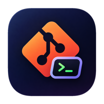
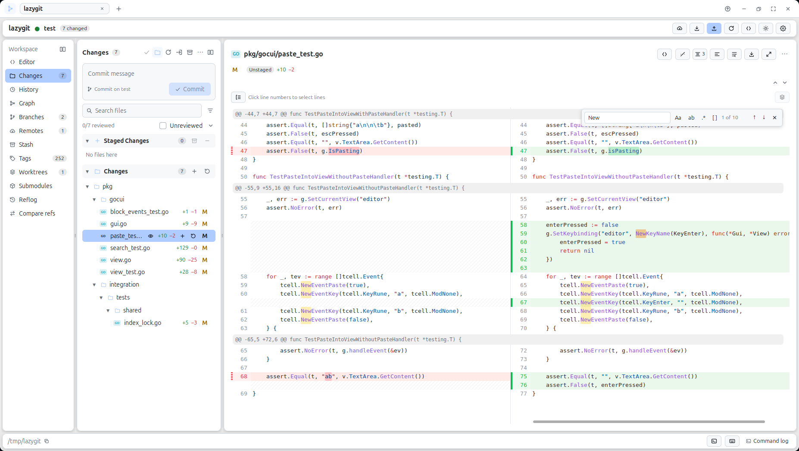
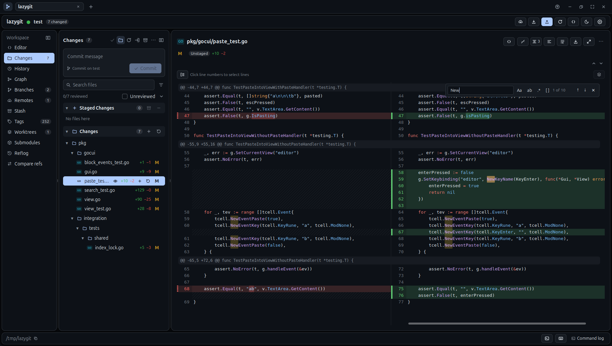
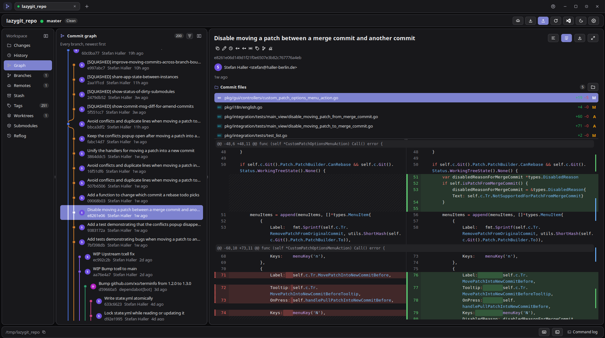
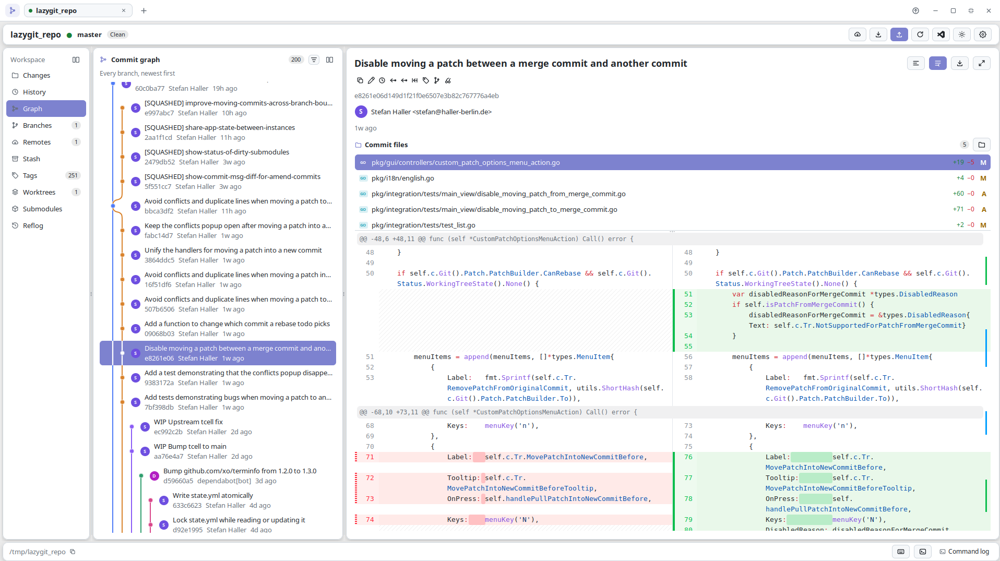
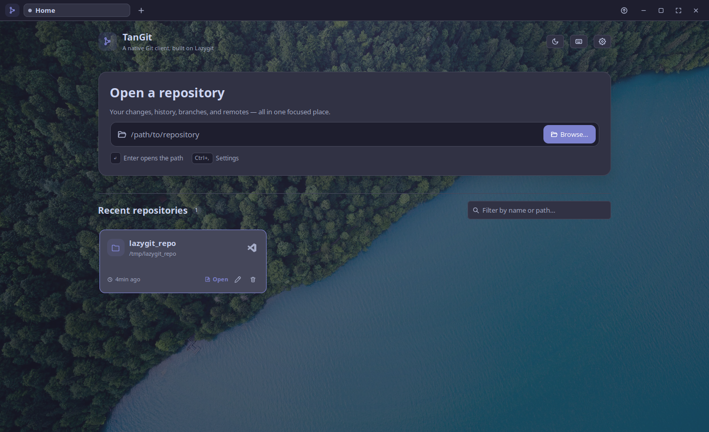
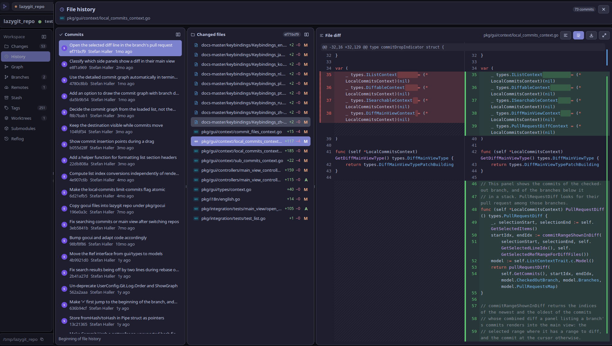
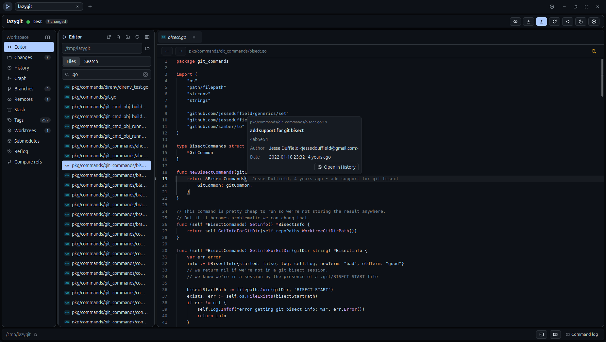
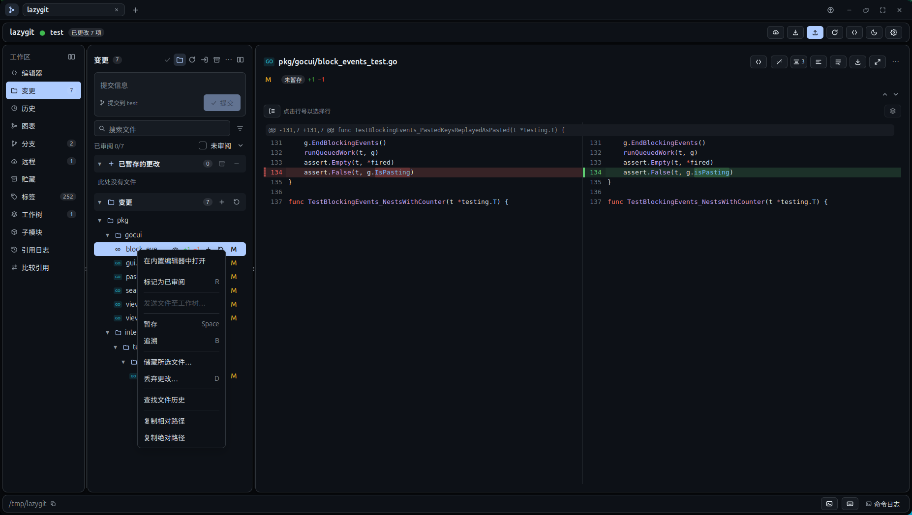

<p align="center">
  
</p>

<h1 align="center">TanGit</h1>

<p align="center"><strong>Precise commits. Visual history. A native Git workspace.</strong></p>
<p align="center">Built with Go and MyGo · macOS · Windows · Linux</p>

<p align="center">
  <a href="https://github.com/FleetingEcho/TanGit/releases">Download</a> ·
  <a href="#features">Features</a> ·
  <a href="#get-started">Get started</a> ·
  <a href="#keyboard-shortcuts">Shortcuts</a> ·
  <a href="#architecture">Architecture</a> ·
  <a href="README-CN.md">简体中文</a>
</p>

<p align="center">
  <picture>
    <source media="(prefers-color-scheme: dark)" srcset="docs/screenshots/workspace.png">
    <source media="(prefers-color-scheme: light)" srcset="docs/screenshots/workspace_light.png">
    
  </picture>
</p>

<p><strong>Screenshot gallery · 8 views</strong></p>

<table>
  <tr>
    <td width="50%"><a href="docs/screenshots/workspace.png"></a><br><sub>Workspace · Dark</sub></td>
    <td width="50%"><a href="docs/screenshots/workspace_light.png"></a><br><sub>Workspace · Light</sub></td>
  </tr>
  <tr>
    <td width="50%"><a href="docs/screenshots/graph_dark.png"></a><br><sub>Commit graph · Dark</sub></td>
    <td width="50%"><a href="docs/screenshots/graph_light.png"></a><br><sub>Commit graph · Light</sub></td>
  </tr>
  <tr>
    <td width="50%"><a href="docs/screenshots/picker.png"></a><br><sub>Repository picker</sub></td>
    <td width="50%"><a href="docs/screenshots/file-history.png"></a><br><sub>File history</sub></td>
  </tr>
  <tr>
    <td width="50%"><a href="docs/screenshots/editor.png"></a><br><sub>Code editor</sub></td>
    <td width="50%"><a href="docs/screenshots/i18n.png"></a><br><sub>Multiple Languages</sub></td>
  </tr>
</table>

## What is TanGit?

TanGit brings Lazygit's Git engine into a native desktop interface, with
keyboard navigation and visual tools for the work that needs a closer look.

- **Turn mixed edits into clean commits.** Stage, unstage, or stash selected lines across separate hunks, keeping the rest of your changes untouched.
- **Shape history visually.** Follow the commit graph and file history, then batch cherry-pick, squash, fix up, drop, or reorder commits.
- **Resolve conflicts in place.** Compare base, current, and incoming versions; choose individual hunks, edit the result, and undo a choice before staging.
- **Keep your development tools together.** Switch repository tabs, edit code with syntax highlighting and language-server assistance, run a shell in the built-in terminal, and open your configured editor with one click.
- **Make the workspace yours.** Resize and expand panels, browse directory trees, and choose from 20 palettes, custom fonts, and six interface languages.

Confirmations explain consequential actions. Force push with lease, eligible
undo/redo operations, and reflog recovery help you manage changes deliberately.

## Features

| | What you can do |
| --- | --- |
| **Changes & diffs** | Stage files or selected lines; review unified, side-by-side, image, and media diffs; export patches. Use Change Courier to preview and copy files, hunks, or lines to another worktree as unstaged changes. |
| **History & graph** | Filter commits, inspect file history, cherry-pick batches, reword, squash, and reorder commits. Pause at a commit with **Edit**, or use **bisect** to find the commit that introduced a problem. Collect whole files, hunks, or lines into a Custom Patch, then safely apply, export, or send it to another worktree. |
| **Branches & recovery** | Manage remotes, tags, stashes, worktrees, and submodules; inspect the reflog and undo eligible operations. Move unpushed commits to a new branch, push a whole stack, and prune stale upstreams. Safety Journal retains durable, revalidated recovery for destructive actions and patch applications. |
| **Collaboration & automation** | Create pull requests and view checks with **GitHub CLI** (`gh`) or **GitLab CLI** (`glab`); push all tags or delete a remote tag; export `format-patch` series and apply mailbox patches with a three-way fallback. Add custom shell commands with optional keybindings, or run one-off commands with `:`. Background fetching and pruning are configurable. |
| **Conflict resolution** | Review base, current, and incoming versions; choose hunks, edit the result, and stage the resolution. |
| **Editor workspace** | Edit with syntax highlighting and language-server assistance; manage files and tabs; use fzf Quick Open, advanced content search, and Markdown preview. |
| **Your workspace** | Repository tabs, directory trees, resizable panels, expanded branch/diff views, a terminal, and external editors. |
| **Your preferences** | Themes, fonts, six interface languages, configurable visible sections, and signed in-app updates. |

Commit actions live in detail panels and right-click menus. Click a diff line
number to start multiple-line selection; Shift-click selects a range.

[Common workflows →](docs/guide.md#common-workflows)

### A code editor inside your Git workspace

- **Write and review code.** Use syntax highlighting, undo/redo, temporary previews and persistent tabs, back/forward navigation, and unsaved-change prompts. Save with `Ctrl/Cmd+S`, save all with `Ctrl/Cmd+Shift+S`, preview Markdown beside its source, and inspect images without another app.
- **Find and understand code.** Open paths with fuzzy fzf matching. Search by case, whole word, or regular expression; add include/exclude globs; page through grouped results; and jump directly to a match. Optional language servers add completion, hover documentation, diagnostics, and go-to-definition.
- **Use your existing tools.** Install a supported language server through TanGit, configure a custom one, or switch the search backend between ripgrep and the built-in Go scanner.
- **Manage files without leaving Editor.** Create files and folders, rename or delete them, and drag items between folders. Drop native files and folders anywhere in the Explorer to copy them into a local workspace or upload them over SFTP, with byte/item progress and cancellation. Open tabs and unsaved buffers follow renames and moves, and a repository subfolder can become the workspace root.
- **Work directly over SSH.** Configure Linux SSH workspaces from Home or Settings with agent, private-key, or password authentication. Git, editing, search, terminals, and recursive transfers run remotely without a mirror or server agent. Local items open in the host file manager; remote **Open in explorer** launches `Narwhal` on the remote desktop (`DISPLAY=:0`).

## Get started

1. Install [Git](https://git-scm.com/) and download a [TanGit release](https://github.com/FleetingEcho/TanGit/releases).
2. Use the **DMG** on macOS, the **setup executable** on Windows, or the matching **`.deb` / archive** on Linux.
3. Open a local repository, choose **Open SSH** to work directly in a remote Linux repository, or choose **Clone** on Home to clone an HTTPS or SSH URL with real progress, optional branch selection, and automatic opening. Cloning uses your existing Git credential helpers or SSH agent; direct SSH profiles keep secrets in the OS keychain when available, with session-only fallback.

Install [ripgrep](https://github.com/BurntSushi/ripgrep) for faster Editor content searches in large repositories. TanGit uses its built-in search when `rg` is unavailable and ranks Quick Open paths and content results with [fzf](https://github.com/junegunn/fzf).

Edit **Workspace folder** and press Enter, or use its folder button, to open a repository subfolder as the Editor root. The Explorer then lists only that folder and its descendants (without ancestor or outside rows), Quick Open and content search use the same scope, root-level file creation or drops target the opened folder, and the external-editor menu opens that folder too. Unsubmitted text remains a draft and does not change the workspace; the clear button restores the entire repository. Optional include/exclude globs stay collapsed under **File filters**. Common generated and dependency folders are excluded before searching. In **Settings → Editor → Search exclusions**, add folder names, remove any default, clear the list, or restore the defaults. Exclusions match at any depth; source folders such as `vendor` remain searchable unless you add them.

Changing branches refreshes the Explorer, reloads clean open documents, and reruns active searches against the new tree. Unsaved editor buffers remain open with a previous-branch warning until you explicitly save them.

**From the terminal**, after [setting up the command for your platform](docs/guide.md#open-a-repository-from-the-terminal):

```sh
tangit .
tangit "./repository with spaces"
```

The command returns immediately and reuses a running TanGit window, selecting
an existing repository tab or opening a new one. The macOS launcher and Windows
PATH need one-time setup. The guide includes instructions for existing
installations and custom app locations.

**From your editor workflow:** choose a preset or command in **Settings → Editor**.
Editor buttons launch it directly. Neovim opens in a terminal; on macOS,
quitting Neovim returns to the shell in the project or file's directory.

## Keyboard shortcuts

| Keys | Action |
| --- | --- |
| `?` / `F1` | Current-context help / complete shortcut reference |
| `Tab` / `Shift+Tab`, `F6` / `Shift+F6` | Move between controls and panels |
| Arrows, `j` / `k` | Navigate the focused list |
| `Space` | Stage or unstage in Changes, including selected diff lines |
| `c` / `Ctrl+Enter` | Compose / submit a commit |
| `Ctrl+I` | Preview and apply a patch or diff in Changes |
| `C` | Clone a remote repository on Home |
| `Ctrl+B` / `B` | Add the chosen commit or historical file / review Custom Patch |
| `A` / `Space` in a historical diff | Add the current hunk / selected changed lines to Custom Patch |
| `p` / `P` | Pull / push |
| `r` / `e` | Reword / pause a rebase to edit a commit |
| `b` | Start a bisect, or mark the current test as bad; `g` good, `k` skip, `R` reset |
| `z` / `Z` | Undo / redo eligible operations |
| `Ctrl+Tab` / `Ctrl+Shift+Tab` | Switch repository tabs |
| `Ctrl+P` / `Ctrl+Shift+F` | Quick open / workspace content search in Editor |
| ``Ctrl+` `` / `Ctrl+,` | Terminal / Settings |
| `:` / `Ctrl+L` | Run a one-off shell command / command log |

Uppercase letters mean **Shift + letter**. Git shortcuts follow the focused
panel; text fields retain normal typing. Attention-requiring actions ask for
confirmation. [More shortcuts →](docs/guide.md#keyboard)

## Architecture

TanGit is a Go application. **MyGo** renders the native UI, and **Lazygit**
provides the Git command layer. Repository sessions keep Git operations and
repository data separate from the views.

Views schedule work and display refreshed repository snapshots. MyGo's
headless tester exercises clicks, typing, keyboard focus, and rendered layouts.

## Build & contribute

Requires Go **1.27.3** and Git. Dependencies are declared in `go.mod`.

```sh
git clone https://github.com/FleetingEcho/TanGit.git
cd TanGit
go tool mygo dev      # develop
go tool mygo build    # build for this platform
```

[Development & checks](docs/guide.md#development) ·
[Release builds & signed updates](docs/guide.md#publishing-signed-updates) ·
[Issues](https://github.com/FleetingEcho/TanGit/issues)

---

[MIT License](LICENSE) · Built with [MyGo](https://github.com/egoist/mygo) and
[Lazygit](https://github.com/jesseduffield/lazygit).
