<p align="center">
  
</p>

<h1 align="center">lazygitGo</h1>

<p align="center">
  <strong>A native desktop Git client with Lazygit's engine, a visual history, and a built-in code editor.</strong>
</p>

<p align="center">
  <a href="https://github.com/FleetingEcho/lazygitGo/releases"></a>
  <a href="LICENSE"></a>
  
  
</p>

<p align="center">
  <a href="https://github.com/FleetingEcho/lazygitGo/releases"><b>Download</b></a> ·
  <a href="#install">Install</a> ·
  <a href="#what-you-can-do">Features</a> ·
  <a href="#keyboard-first">Shortcuts</a> ·
  <a href="docs/guide.md">Guide</a> ·
  <a href="README-CN.md">简体中文</a>
</p>

<p align="center">
  <picture>
    <source media="(prefers-color-scheme: dark)" srcset="docs/screenshots/graph.png">
    <source media="(prefers-color-scheme: light)" srcset="docs/screenshots/graph.png">
    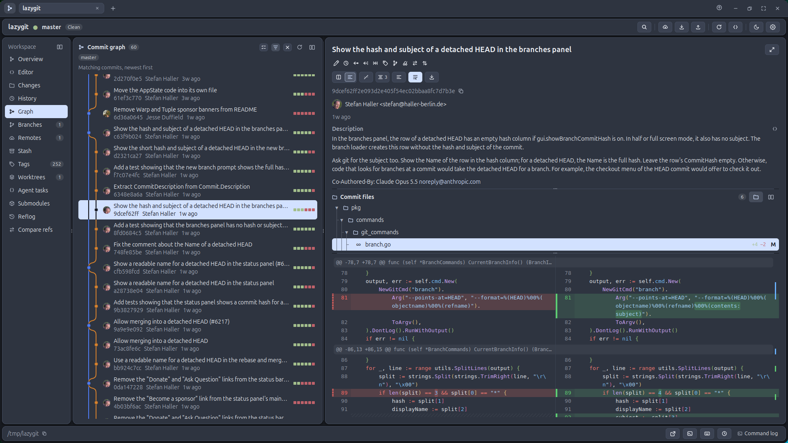
  </picture>
</p>

## Why lazygitGo?

[Lazygit](https://github.com/jesseduffield/lazygit) is fast because you never
leave the keyboard. A graphical client is easier when you need to *see* a
history, a conflict, or a diff. lazygitGo gives you both: Lazygit's Git
command layer, wrapped in a native window with visual tools where they help.

|  |  |
| --- | --- |
| 🎯 **Precise commits** | Stage, unstage, discard or stash individual lines across hunks. The rest of your changes stay untouched. |
| 🌳 **Visual history** | Follow the commit graph and file history. Cherry-pick, squash, fix up, drop and reorder commits in batches. |
| 🧩 **Safer conflicts** | Compare Base, Current, Incoming and Result side by side, pick hunks, edit the result, and undo a choice before staging. |
| 🛟 **Recovery built in** | Reflog, a durable Safety Journal and per-file conflict recovery. Risky actions explain themselves and ask first. |
| 💻 **One workspace** | A code editor, search, terminal and SSH workspaces sit beside your repository tabs. |
| 🌏 **Your language** | The whole interface is translated into six languages: English, 简体中文, 繁體中文, 日本語, Español and Français. Switch any time in **Settings → Appearance**. |

## What you can do

### Commit exactly what you mean

- **Line-level staging.** Click a diff line number to start a selection and Shift-click for a range. Press `m` for **Select changes**: stage, unstage or discard the current hunk or the lines you picked.
- **Unified, side-by-side, image and media diffs**, patch export, and **Apply patch…** for external `.patch` / `.diff` files (`Ctrl+I`).
- **Custom Patch.** Collect changes from commits and historical files, then export them, apply them to the working tree, or move them to another commit or the index.
- **Change Courier** previews a patch and copies it to another worktree as unstaged changes, with no history rewrite.

### Understand and reshape history

- **Commit graph and file history** with filtering, blame, and bisect (`b`, `g`, `k`, `R`).
- **Batch rewrites:** reword, squash, fixup, drop, reorder, edit an older commit (`e`), or rebase `--onto` a marked base.
- **Rebase TODO** shows Git's real interactive todo list and lets you edit it with compare-and-swap checks.
- **Sync stack…** previews per-branch merge, rebase and update-ref plans, validates them, then optionally publishes each branch with a lease.
- Manage remotes, tags, stashes, worktrees and submodules. Export or import `format-patch` series.

### Resolve conflicts where you review diffs

<p align="center">
  <picture>
    <source media="(prefers-color-scheme: dark)" srcset="docs/screenshots/merge_conflict_dark_theme.png">
    <source media="(prefers-color-scheme: light)" srcset="docs/screenshots/merge_conflict_light_theme.png">
    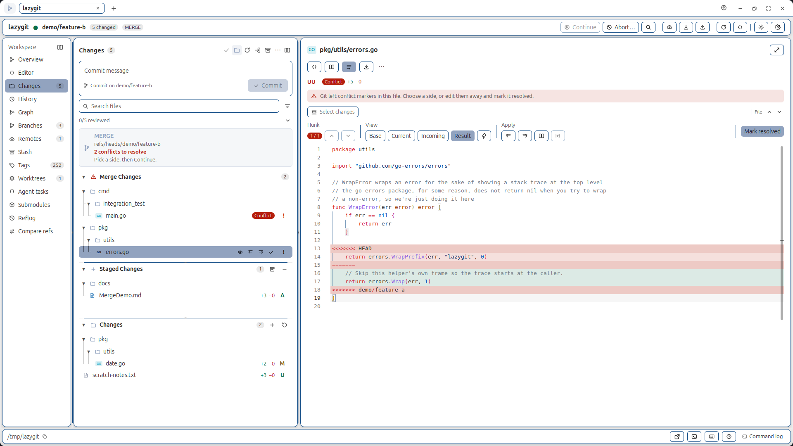
  </picture>
</p>

- Four-pane **Base / Current / Incoming / Result** view with hunk, side and Result controls that adapt to narrow windows.
- An operation card that reads Git's real state (merge, rebase, `am`, cherry-pick, revert) and offers only the valid **Continue**, **Skip** and **Abort**.
- **Guided mode** shows a live checklist: read the conflict, choose or edit Result, mark resolved, review staged, continue.
- **Continue preflight** can run your own required and optional checks (for example `go test ./...`) before an operation continues.
- **Durable recovery** keeps each file's original unresolved bytes and index stages, and refuses to overwrite newer work.
- Optional **Conflict Assistant** and **Change Splitter** call a helper command you configure. They only suggest, and nothing is staged or committed for you.

### See the state of the repository at a glance

- **Overview** is the landing page: what needs attention next, working tree and operation state, pull request checks, Agent tasks, and recent activity.
- **Contributors** (by period and branch), a **commit heat map**, **code changes** (lines added and removed) and **branch health** (merged, stale and far-behind branches).
- **Command Palette** (`Ctrl/Cmd+Shift+P`) runs any action. Prefix it to switch modes: `@` branches, `#` commits, `/` files, `~` recent repositories, `!` shell.
- **Activity Center** (`Ctrl/Cmd+Shift+A`) gathers commands, Safety Journal records, Agent tasks, transfers and notices across open repositories.
- A filterable **Command Log** shows every Git command that ran, with its output.

### Code without leaving Git

- **Editor** with syntax highlighting, tabs, Markdown preview, image viewing, rename-aware buffers and optional **language servers** (completion, hover, diagnostics, go-to-definition, formatting).
- **Search.** `Ctrl+P` quick-opens files with fzf matching. `Ctrl+Shift+F` searches contents by case, whole word or regex, with include/exclude globs and folder scoping. On macOS and Linux a local [Zoekt](https://github.com/sourcegraph/zoekt) index is built in the background, so searches in large repositories stay fast. Without it, lazygitGo falls back to ripgrep, then to a built-in scanner. Search exclusions and the index are configurable in Settings. [Details →](docs/guide.md#code-search-backends-index-and-exclusions)
- **Files.** Create, rename, delete, drag and drop, and open any repository subfolder as the workspace root.
- **Built-in terminal** that can dock on any edge, plus one-click launch of your external editor.
- **SSH workspaces.** Git, editing, search, terminals and SFTP transfers run directly on a remote Linux host, with no mirror and no server agent.

### Automate and collaborate

- Create pull requests and read checks with the GitHub CLI (`gh`) or GitLab CLI (`glab`).
- **Agent tasks** give each task an isolated branch and worktree, with durable state and review. Drive them from a local `lazygitGo agent …` CLI or RPC. See [Agent workspaces](docs/agent-workspaces.md) and [automation](docs/agent-automation.md).
- Add **custom commands** with placeholders such as `{{branch}}` and `{{file}}`, and optional shortcuts.
- Configurable background fetch and prune, 20 colour palettes, custom fonts and signed in-app updates.
- **Six interface languages**: English, 简体中文, 繁體中文, 日本語, Español and Français. Menus, dialogs, tooltips, errors and the command palette are all translated. See the screenshot below.

## Screenshots

<table>
  <tr>
    <td width="50%"><a href="docs/screenshots/overview_dark.png">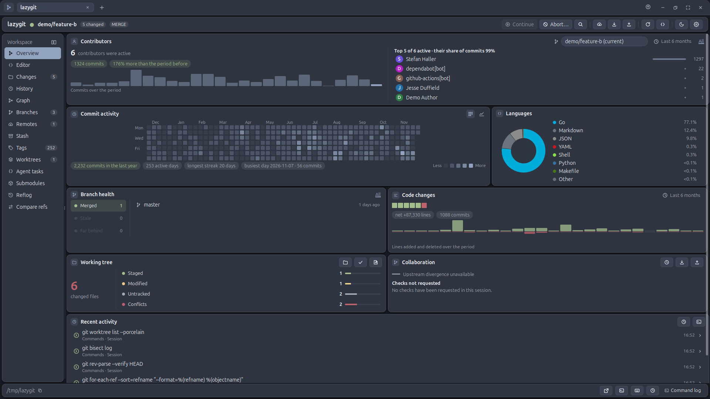</a><br><sub>Overview · Dark</sub></td>
    <td width="50%"><a href="docs/screenshots/overview_light.png">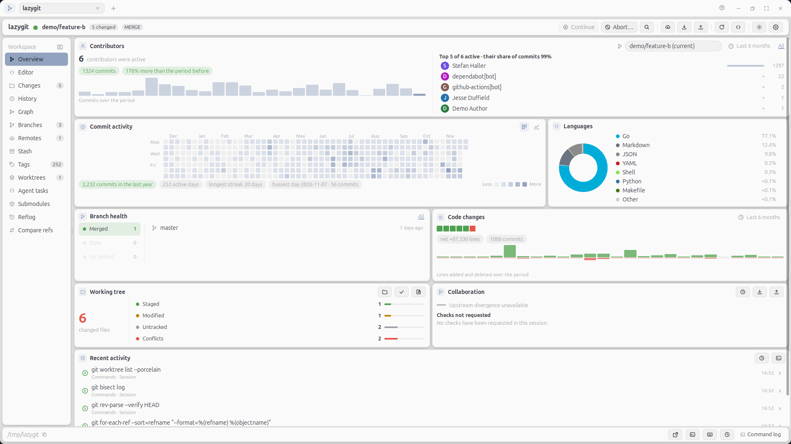</a><br><sub>Overview · Light</sub></td>
  </tr>
  <tr>
    <td width="50%"><a href="docs/screenshots/history.png">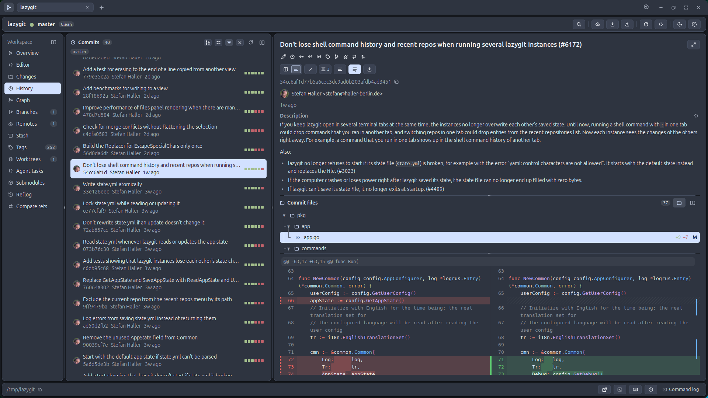</a><br><sub>History</sub></td>
    <td width="50%"><a href="docs/screenshots/graph.png"></a><br><sub>Commit graph</sub></td>
  </tr>
  <tr>
    <td width="50%"><a href="docs/screenshots/file_history.png">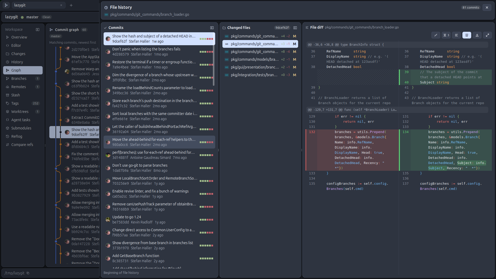</a><br><sub>File history</sub></td>
    <td width="50%"><a href="docs/screenshots/commit_context_menu.png">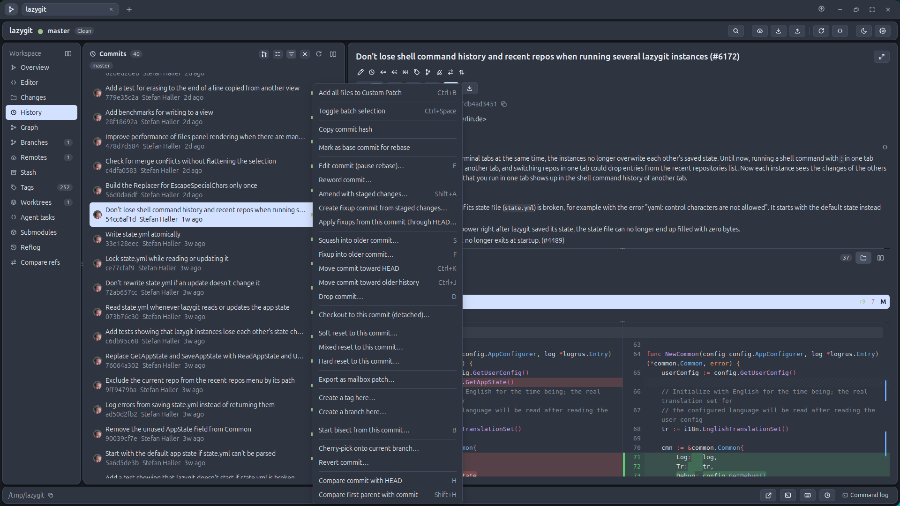</a><br><sub>Commit actions</sub></td>
  </tr>
  <tr>
    <td width="50%"><a href="docs/screenshots/command_palette.png">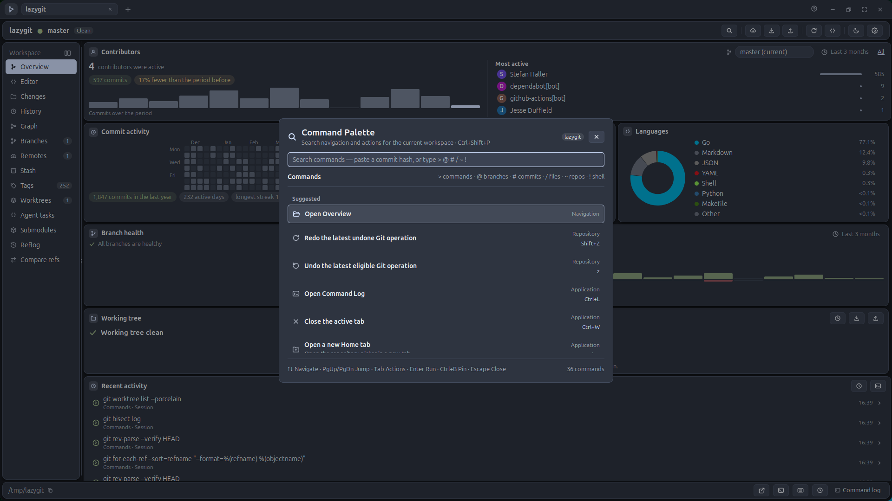</a><br><sub>Command Palette</sub></td>
    <td width="50%"><a href="docs/screenshots/keyboard_shortcuts.png">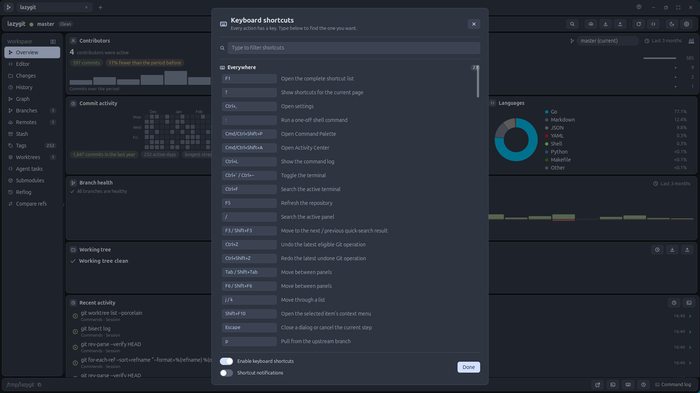</a><br><sub>Keyboard shortcuts</sub></td>
  </tr>
  <tr>
    <td width="50%"><a href="docs/screenshots/remote_branches.png">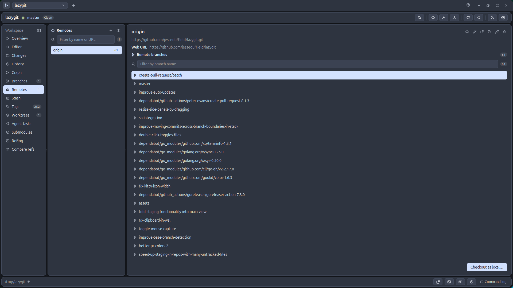</a><br><sub>Remotes and remote branches</sub></td>
    <td width="50%"><a href="docs/screenshots/terminal.png">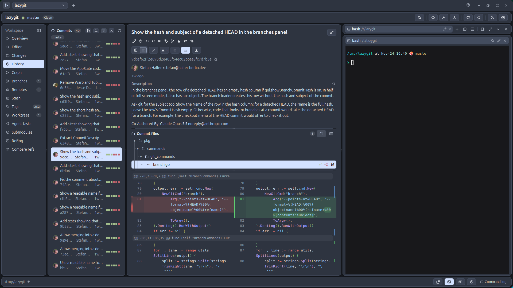</a><br><sub>Built-in terminal</sub></td>
  </tr>
  <tr>
    <td width="50%"><a href="docs/screenshots/editor.png">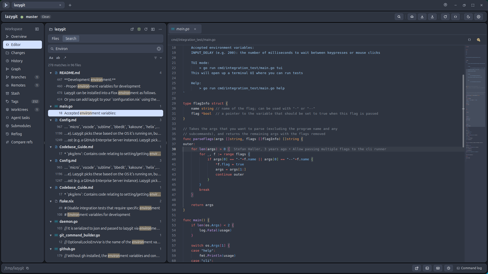</a><br><sub>Editor and search</sub></td>
    <td width="50%"><a href="docs/screenshots/tokyo_night_theme.png">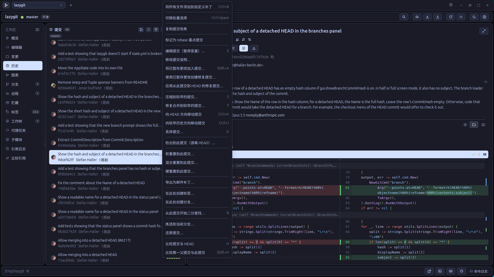</a><br><sub>Tokyo Night theme</sub></td>
  </tr>
  <tr>
    <td colspan="2" align="center"><a href="docs/screenshots/i18n.png"></a><br><sub>Interface languages · light theme</sub></td>
  </tr>
</table>

<p align="center"><sub>Screenshots show the open-source <a href="https://github.com/jesseduffield/lazygit">Lazygit</a> repository.</sub></p>

## Install

1. Install [Git](https://git-scm.com/).
2. Download the package for your system from the [releases page](https://github.com/FleetingEcho/lazygitGo/releases).

| System | Package |
| --- | --- |
| macOS (universal) | `.dmg` |
| Windows (AMD64, ARM64) | setup executable |
| Linux (AMD64, ARM64) | `.deb` or archive. Debian: `sudo apt install ./lazygitgo_*.deb` |

3. Open a local repository, choose **Open SSH** for a remote Linux repository, or choose **Clone** on Home to clone an HTTPS or SSH URL with real progress. Cloning uses your existing Git credential helpers or SSH agent.

**Upgrading from TanGit?** Open **Settings → Updates → Check for updates**. Your
settings, recent repositories and workspaces carry over. Debian users install the
new `.deb`, which replaces `tangit`. [Upgrade details](docs/guide.md#upgrade-from-tangit)

**Optional:** install [ripgrep](https://github.com/BurntSushi/ripgrep) for faster
content search in large repositories.

### Open a repository from the terminal

```sh
lazygitGo .
lazygitGo "./repository with spaces"
```

The command returns immediately and reuses a running window, selecting an
existing tab or opening a new one. macOS and Windows need
[one-time setup](docs/guide.md#open-a-repository-from-the-terminal).

> **Compatibility note.** Verification is tied to the Git and SSH versions
> recorded in its logs. **Git 2.32 has not been verified.** See
> [version and capability evidence](docs/verification.md#version-and-capability-evidence).

## Keyboard first

Press `?` for help on the current panel and `F1` for the searchable shortcut
reference. Uppercase means **Shift + letter**. Git keys follow the focused
panel, and text fields keep normal typing.

| Keys | Action |
| --- | --- |
| `Ctrl/Cmd+Shift+P` | Command Palette (`@` `#` `/` `~` `!` modes) |
| `Ctrl/Cmd+Shift+A` | Activity Center |
| `Space` | Stage or unstage, including selected diff lines |
| `c` / `Ctrl+Enter` | Compose / submit a commit |
| `p` / `P` | Pull / push |
| `z` / `Z` | Undo / redo eligible operations |
| `r` / `e` | Reword / pause a rebase to edit a commit |
| `m` | Select changes in a Changes diff |
| `Ctrl+B` / `B` | Add to / review Custom Patch |
| `Ctrl+P` / `Ctrl+Shift+F` | Quick open / search contents in Editor |
| `Ctrl+Tab` | Next repository tab |
| ``Ctrl+` `` / `Ctrl+,` | Terminal / Settings |
| `:` / `Ctrl+L` | One-off shell command / command log |

[All shortcuts →](docs/guide.md#keyboard)

## Safety by design

- Consequential actions explain themselves and ask first. Force push uses a lease.
- History edits and recovery use **compare-and-swap** checks, so a stale view is refused instead of overwriting newer work.
- Check commands and `AssistCommand` helpers are **trusted local commands, not a sandbox**. Nothing runs unless you configure it.

Details: [operation recovery, history and assisted review](docs/guide.md#operation-recovery-history-and-assisted-review).

## Documentation

| | |
| --- | --- |
| [Guide](docs/guide.md) | Common workflows, Command Palette, Overview, recovery, shortcuts, development |
| [Agent workspaces](docs/agent-workspaces.md) · [Automation](docs/agent-automation.md) | Isolated task worktrees and the local CLI/RPC |
| [Verification](docs/verification.md) | CI matrix, tested Git versions and their limits |
| [Performance](docs/performance.md) | Large-repository refresh behaviour and measurements |
| [Release notes](docs/releases/) | What changed in each version |

## Build from source

Requires Go **1.27.3** and Git. On Linux, packages use GTK 3 and AppIndicator.

```sh
git clone https://github.com/FleetingEcho/lazygitGo.git
cd lazygitGo
go tool mygo dev      # run in development mode
go tool mygo build    # build on macOS or Linux
bash scripts/build-windows.sh windows/amd64   # build the Windows installer
```

Before opening a pull request:

```sh
gofmt -l . && go vet ./... && go tool mygo vet . && CGO_ENABLED=0 go test ./...
```

New UI strings go through `tr(...)` and need a translation in every catalog under
`internal/app/i18n*.go`. See [Development](docs/guide.md#development) and
[Publishing signed updates](docs/guide.md#publishing-signed-updates).

**Architecture in brief:** the app is written in Go. [MyGo](https://github.com/egoist/mygo)
renders the native UI, and Lazygit provides the Git command layer. Views schedule
work and display repository snapshots, and MyGo's headless tester drives clicks,
typing, focus and layout in tests.

---

<p align="center">
  <a href="LICENSE">MIT License</a> · Built with <a href="https://github.com/egoist/mygo">MyGo</a> and <a href="https://github.com/jesseduffield/lazygit">Lazygit</a> ·
  <a href="https://github.com/FleetingEcho/lazygitGo/issues">Report an issue</a>
</p>
